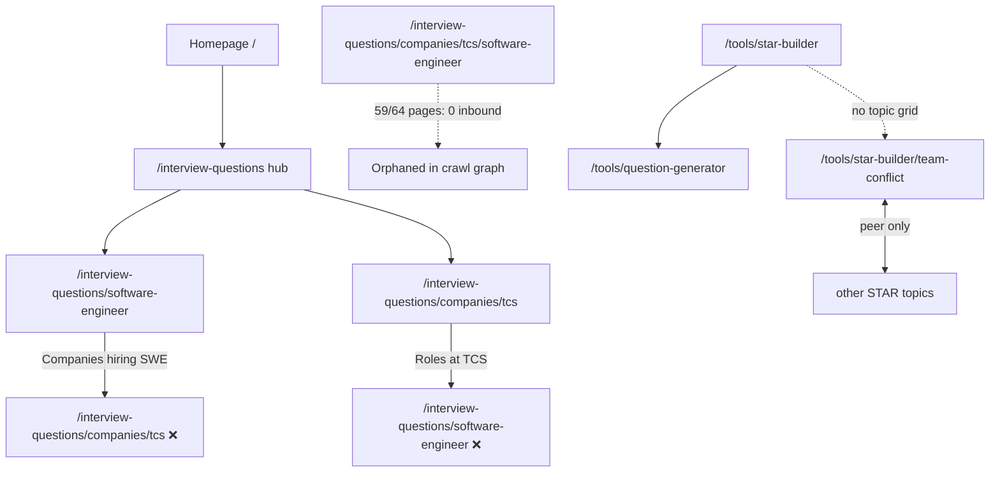
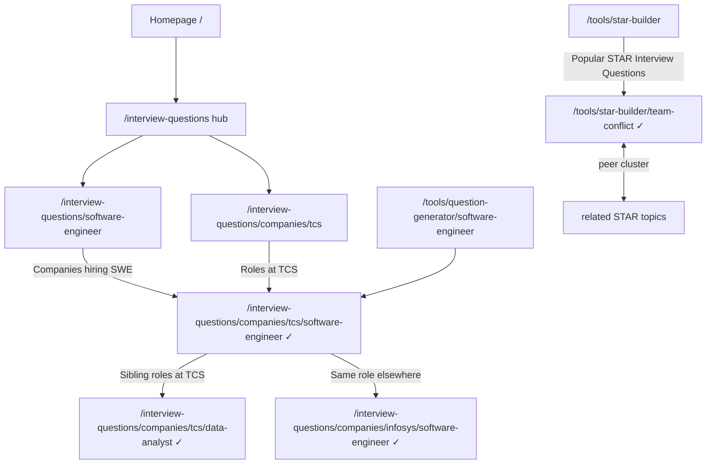

# Internal Linking Architecture — Diff Report

Generated: 2026-06-14  
Scope: Highest-impact crawl architecture fixes only (intersection canonical linking + STAR landing hub).

---

## Files changed

| File | Change |
|------|--------|
| `src/lib/seo/internal-linking/engine.ts` | Added intersection link helpers; retargeted role, company, intersection, and QGen tool sections to `intersectionQuestionsPath()` for `HIGH_VALUE_INTERSECTIONS` only; added `buildStarBuilderLandingLinks()` |
| `src/lib/seo/internal-linking/index.ts` | Exported `buildStarBuilderLandingLinks` |
| `src/app/(marketing)/tools/star-builder/page.tsx` | Added contextual **Popular STAR Interview Questions** section via `SeoCrossLinksSection` |
| `.crawl-priority-out/analyze.ts` | Models STAR landing topic links in link-graph simulation |

**Not changed:** footer (`FOOTER_INTERVIEW_QUESTIONS_LINKS` remains 8 links), sitemap registry, canonical/metadata/schema builders, routing, auth, or business logic.

---

## Previous link graph (before)



**Problems:**
- Role and company pages sent “company × role” anchor text to **hub URLs**, not canonical intersection pages.
- Intersection sibling sections on intersection pages also pointed at role/company hubs.
- 59 of 64 `HIGH_VALUE_INTERSECTIONS` had **zero** simulated inbound internal links.
- 20 STAR topic pages were **unreachable** from `/` in BFS crawl simulation (peer-only subgraph).
- Company/role hubs absorbed link equity meant for long-tail intersection URLs.

---

## New link graph (after)



**Guards preserved:**
- Only pairs in `HIGH_VALUE_INTERSECTIONS` (via `intersectionsForRole` / `intersectionsForCompany`) receive intersection links — no full company×role matrix.
- Section caps (`MAX_COMPANY_LINKS`, `MAX_INTERSECTION`, etc.) unchanged.
- Parent hub links on intersection pages retained (`All TCS questions`, `All SWE questions`, hub).

---

## Number of new internal links

| Metric | Before | After | Delta |
|--------|--------|-------|-------|
| Total inbound edge instances (sitewide) | 12,014 | 12,034 | **+20 net** |
| Links retargeted hub → intersection | — | — | **654 rewired** (same outbound count on source pages) |
| STAR landing → topic links | 0 | 20 | **+20 new** |
| Intersection pages with 0 inbound | 59 / 64 | 0 / 64 | **−59** |
| Avg incoming (intersection category) | 21 | 31 | +10 |
| Avg incoming (STAR topic pages) | 4.0 | 5.0 | +1.0 |
| Footer IQ links | 8 | 8 | 0 |

**Interpretation:** Outbound link *counts* on role, company, and tool pages are unchanged; href targets now resolve to canonical intersection URLs. The only additive edges are 20 STAR topic links from the landing page. Hub pages (company/role) lost ~654 redundant inbound links that incorrectly duplicated intersection intent.

---

## Crawl depth before vs after

| Metric | Before | After |
|--------|--------|-------|
| Max BFS depth from `/` | 4 | **4** (unchanged) |
| Indexable URLs unreachable from `/` | **79** | **0** |
| Unreachable breakdown | 59 intersections + 20 STAR topics | — |
| Intersection depth range | null (majority) | **1–3** |
| STAR topic depth | null | **2** (`/` → `/tools/star-builder` → topic) |
| `/tools/star-builder` depth | 1 | 1 |

Crawl depth was **not increased**; previously orphaned pages were connected within the existing ≤4-hop budget.

---

## Expected SEO impact

1. **Faster discovery of intersection pages** — All 64 high-value company×role URLs are now on the crawl path from `/` with contextual anchors (e.g. “TCS SWE questions”) instead of competing hub URLs.
2. **Correct canonical signal reinforcement** — Internal anchors align with sitemap URLs (`/interview-questions/companies/{company}/{role}`), reducing ambiguity between hub and intersection pages for the same query intent.
3. **STAR topic cluster cohesion** — Landing page acts as a topical hub linking all 20 behavioral pages at depth 2; complements existing peer links on topic pages.
4. **No link-farm risk** — Footer unchanged; new links live in labeled contextual sections with existing caps and deduplication.
5. **Hub pages** — Company/role hubs retain peer, tool, guide, and parent links; they lose misdirected intersection-intent links (appropriate consolidation).

---

## Regression risks

| Risk | Likelihood | Mitigation |
|------|------------|------------|
| Hub page ranking softens for queries that matched intersection intent | Low–medium | Hubs still indexed; intersection pages gain the more specific links. Monitor GSC for hub vs intersection impressions. |
| Duplicate anchor text across many role pages pointing to same intersection | Low | Pre-existing pattern (same labels, different href). Caps limit repetition per page. |
| STAR landing section adds visual weight below fold | Low | Uses existing `SeoCrossLinksSection` pattern from topic pages; no new styling system. |
| `buildStarBuilderLandingLinks` topic count grows with `STAR_TOPICS` | Low | Section scales with catalog; sitemap already includes all topics. |
| Analyze script drift from production chrome | Low | Script updated to mirror landing links; re-run with `npx tsx .crawl-priority-out/analyze.ts`. |

**Verified unchanged:** canonical URLs, `generateMetadata` paths, JSON-LD on STAR landing, sitemap entries, robots/indexing rules, authentication, routing.

---

## Verification

```bash
npx tsx .crawl-priority-out/analyze.ts
```

Before snapshot preserved at `.crawl-priority-out/all-audits-before.json` and `report-before.json`.
