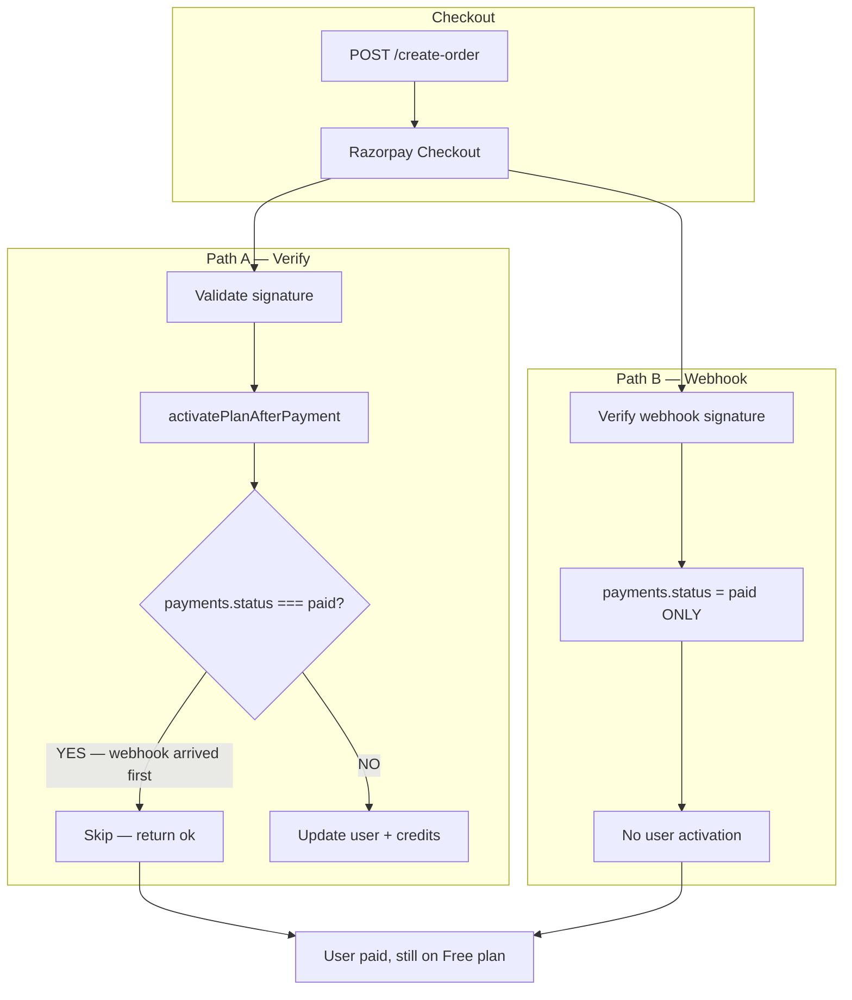
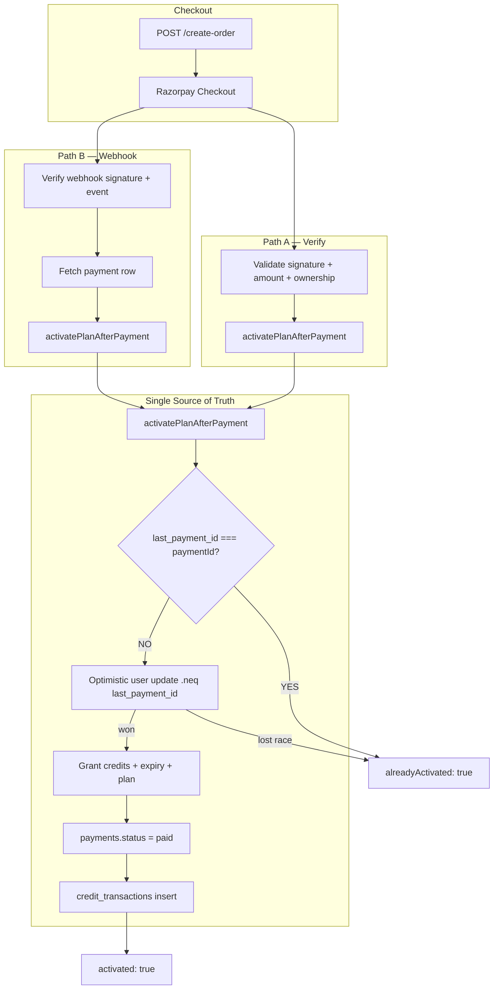

# Payment Architecture — Dual-Path Idempotent Activation

Generated: 2026-06-14

---

## 1. Before vs After architecture

### Before (broken — two failure modes)



**Failure mode A (original bug):** Webhook set `payments.status = 'paid'` without activating the user. Verify called `activatePlanAfterPayment()`, which treated `payments.status === 'paid'` as “already activated” and returned early — no credits, no tier change.

**Failure mode B (webhook-only refactor):** Activation moved entirely to webhook. If webhook is delayed, fails, or retries later, the customer has paid but has no access until webhook succeeds.

---

### After (production-grade — order of arrival does not matter)



**Key invariants:**
- **Payment state** (`payments.status`) — audit ledger only, never used as activation marker
- **User state** (`users.plan_tier`, credits, expiry) — access grant
- **Idempotency marker** — `users.last_payment_id === paymentId`
- **Both paths** call the same function — whichever arrives first activates; the other replays safely
- **Ownership ≠ completeness** — `last_payment_id` proves the CAS winner; replay must still verify/heal the local payment binding, one payment-owned ledger row, and exact campaign consumption
- **Historical entitlement snapshot** — new activations persist credits/start/expiry on the server-owned payment row before CAS; recovery never recalculates them from current pricing or extends expiry
- **Provider proof before ownership** — verify and webhook fetch Razorpay order/payment entities and must match their IDs, amount, INR currency, and successful statuses to the frozen local order before the CAS

---

## 2. Execution flow

```mermaid
sequenceDiagram
  participant Client
  participant Verify as POST /verify
  participant Webhook as POST /webhook
  participant Activate as activatePlanAfterPayment
  participant Users as users
  participant Payments as payments
  participant Ledger as credit_transactions

  Note over Client,Webhook: Either path may arrive first — both are safe

  Client->>Verify: razorpay_order_id, payment_id, signature
  Verify->>Verify: HMAC + Razorpay order fetch + amount check
  Verify->>Activate: source=verify

  Webhook->>Webhook: x-razorpay-signature HMAC
  Webhook->>Activate: source=webhook

  Activate->>Activate: [ACTIVATE_START] validate order row
  Activate->>Users: SELECT last_payment_id

  alt last_payment_id === paymentId
    Activate-->>Verify: alreadyActivated: true
    Activate-->>Webhook: alreadyActivated: true
  else First activation
    Activate->>Users: UPDATE ... WHERE last_payment_id != paymentId
    Note over Activate,Users: Only one concurrent caller wins
    Activate->>Activate: [USER_UPDATED] [CREDITS_GRANTED]
    Activate->>Payments: status = paid
    Activate->>Activate: [PAYMENT_UPDATED]
    Activate->>Ledger: INSERT credit row
    Activate->>Activate: [LEDGER_WRITTEN] [ACTIVATE_SUCCESS]
    Activate-->>Verify: activated: true
    Activate-->>Webhook: activated: true
  end

  Verify-->>Client: { ok, activated | alreadyActivated, plan, planExpiresAt }
  Client->>Client: redirect /dashboard (no polling)
```

---

## 3. Files changed

| File | Role |
|------|------|
| `src/lib/razorpay/activate-plan.ts` | **Single source of truth** — plan, credits, expiry, payment row, ledger, `last_payment_id` |
| `src/lib/razorpay/activation-api-response.ts` | Maps internal result → explicit HTTP body (`activated` / `alreadyActivated` / `activationFailed`) |
| `src/app/api/payments/verify/route.ts` | Validates Razorpay payload → calls `activatePlanAfterPayment()` |
| `src/app/api/payments/webhook/route.ts` | Validates webhook → calls `activatePlanAfterPayment()` on `payment.captured` / `order.paid` |
| `src/lib/razorpay/payment-log.ts` | Structured logs with `order_id`, `payment_id`, `user_id` |
| `src/components/pricing/CheckoutButton.tsx` | Uses verify response directly — no plan polling |
| `src/lib/razorpay/activate-plan.test.ts` | 11 scenarios — dual-path, concurrency, renewal, upgrade |
| `src/lib/razorpay/activation-api-response.test.ts` | API response mapping tests |

No database migration required — uses existing `users.last_payment_id` and `users.last_order_id` columns.

---

## 4. Root cause (production incident)

**Symptom:** Payment `pay_T1Xu1KmV48WWzM` (₹149 Starter) succeeded in Razorpay dashboard; user `airesumebuilderdotcom@gmail.com` remained on Free plan.

**Root cause:** Race between webhook and verify. The webhook handler updated `payments.status = 'paid'` without touching the user row. When verify ran `activatePlanAfterPayment()`, the function used `payments.status === 'paid'` as a proxy for “already activated” and returned early (`skipped: true`) without granting credits or updating `plan_tier`.

**Why it surfaced after LIVE KYC:** New webhook endpoint became active; webhook began winning the race consistently.

---

## 5. How race conditions are eliminated

| Scenario | Old behavior | New behavior |
|----------|--------------|--------------|
| Webhook before verify | User never activated | Webhook activates; verify returns `alreadyActivated: true` |
| Verify before webhook | User activated | Verify activates; webhook returns `alreadyActivated: true` |
| Simultaneous verify + webhook | Undefined / double credits possible | Optimistic lock: one wins, other replays |
| Duplicate webhook retry | Could double-credit if logic wrong | `last_payment_id` match → no-op |
| Duplicate verify (refresh/retry) | Could double-credit | Same idempotency marker |
| Webhook delayed 30+ seconds | Webhook-only: user stuck on Free | Verify activates immediately on checkout success |

**Concurrency mechanism (compare-and-swap):**

```sql
-- First purchase (last_payment_id IS NULL):
UPDATE users SET ... last_payment_id = $paymentId
WHERE id = $userId AND last_payment_id IS NULL;

-- Renewal / upgrade (last_payment_id = $observed):
UPDATE users SET ... last_payment_id = $paymentId
WHERE id = $userId AND last_payment_id = $observed;
```

**Critical:** Do not use `last_payment_id != $paymentId` — in SQL, `NULL != value` is unknown, so first-time buyers never match and every request returns "Activation conflict".

If zero rows returned, re-read `last_payment_id` (with brief backoff for commit visibility):
- Matches `paymentId` → `alreadyActivated: true` (concurrent winner finished — e.g. verify read `pay_old`, webhook set `pay_new`)
- Still different → `activationFailed: true` (true conflict, safe to retry)

---

## 6. Why activation is idempotent

**Marker:** `users.last_payment_id === paymentId` — never `payments.status`.

| Request pattern | Credits | Expiry | Ledger | Payment row |
|-----------------|---------|--------|--------|-------------|
| First call (verify or webhook) | +N once | extended once | 1 payment-owned row | `paid` |
| Second call, complete state | 0 | unchanged | 0 | unchanged |
| Replay after partial local write | 0 | unchanged | heal missing row exactly once | heal binding/status |
| N duplicate/concurrent retries | 0 | unchanged | still exactly 1 | `paid` |

### Activation completeness and replay healing

`users.last_payment_id === paymentId` is the ownership marker, not a completion marker. After ownership, `complete_payment_activation_local` runs as a service-role-only PostgreSQL function and locks the exact user/payment rows. In one local transaction it:

1. verifies exact user/order/payment ownership and rejects mismatches;
2. verifies the immutable entitlement snapshot (or recognizes an already-linked legacy-complete ledger row);
3. heals `payments.payment_id/status` without using `payments.status` as ownership;
4. links or inserts exactly one `credit_transactions` row using the unique `payment_id` identity;
5. changes no user balance, plan, start, or expiry.

Campaign consumption remains the existing exact-redemption RPC after local completion. A campaign failure returns a retryable activation failure; replay retries only that same redemption. A physically absent base order row or ambiguous historical ledger fails closed because original payment/entitlement authority cannot be reconstructed safely.

**Response types (no ambiguous `skipped`):**

```typescript
// Fresh activation
{ ok: true, activated: true, alreadyActivated: false, plan, planExpiresAt }

// Idempotent replay
{ ok: true, activated: false, alreadyActivated: true, plan, planExpiresAt }

// Failure (retry-safe for webhook, 500 for verify)
{ ok: false, activationFailed: true, error: string }
```

Funnel analytics (`payment_completed`) fires only on fresh activation (`activationWasFresh()`).

### Provider-to-local validation boundary

`resolveExpectedOrderAmount()` remains the local expectation lookup: it returns the order’s stored amount, currency, owner, plan, and exact campaign reservation linkage. It never re-quotes a campaign. `provider-payment-validation.ts` separately compares that expectation to the Razorpay payment entity (`id`, `order_id`, amount, `INR`, `captured`) and order entity (`id`, amount, `INR`, `paid`, notes owner/plan).

Both verify and webhook run that contract before `activatePlanAfterPayment()`. Provider mismatch fails closed with no ownership CAS, entitlement, recovery, ledger, or campaign mutation. `activatePlanAfterPayment()` additionally rejects a different existing `payments.payment_id` before its CAS. This protects the Phase 7A recovery boundary: replay/healing is permitted only after trusted provider validation has established the exact payment/order identity.

Discounted campaign amounts remain historical: Starter ₹209/₹149 and Pro ₹559/₹399 validate against the frozen `payments.amount` and linked redemption’s `final_amount_paise`, not current list price or campaign availability.

---

## 7. Automated test coverage

`src/lib/razorpay/activate-plan.test.ts` — all scenarios assert exactly-once semantics:

| Test | Proves |
|------|--------|
| Verify first | Immediate activation via verify-only path |
| Webhook first (payment row already paid) | Activation despite `payments.status = paid` |
| Verify then webhook | Credits granted once |
| Webhook then verify | Credits granted once |
| Webhook only | Standalone activation |
| Simultaneous verify + webhook | One fresh + one replay |
| Duplicate webhook retries | Idempotent |
| Duplicate verify retries | Idempotent |
| Renewal + leftover credits | Expiry extended from existing date |
| Starter → Pro upgrade | Tier + credits + new `last_payment_id` |
| Existing leftover credits | Credits stack on first purchase |

Run: `npx vitest run src/lib/razorpay/activate-plan.test.ts`

---

## 8. Structured log reference

Grep Vercel logs: `[payment:*]`

| Stage | Log event | Scope |
|-------|-----------|-------|
| CREATE_ORDER | `create_order_start`, `create_order_done` | `create-order` |
| VERIFY_START | `verify_start` | `verify` |
| VERIFY_SUCCESS | `verify_success` | `verify` |
| WEBHOOK_RECEIVED | `webhook_received` | `webhook` |
| ACTIVATE_START | `activate_start` | `activate` |
| ALREADY_ACTIVATED | `already_activated` | `activate` |
| USER_UPDATED | `user_updated` | `activate` |
| CREDITS_GRANTED | `credits_granted` | `activate` |
| PAYMENT_UPDATED | `payment_updated` | `activate` |
| LEDGER_WRITTEN | `ledger_written` | `activate` |
| ACTIVATE_SUCCESS | `activate_success` | `activate` |

Every activation log includes `order_id`, `payment_id`, `user_id`.

---

## 9. Regression risks

| Risk | Severity | Mitigation |
|------|----------|------------|
| Partial deploy (old verify + new webhook or vice versa) | High | Deploy all payment files atomically |
| Webhook secret mismatch | High | Monitor `[payment:webhook] invalid_signature`; returns 400 |
| User CAS succeeds, payment/ledger completion fails | Medium | Returns 500; replay atomically heals missing local artifacts without changing entitlement |
| `order.paid` without `payment.id` | Low | Logged `missing_payment_id`; `payment.captured` always includes payment id |
| Campus users attempting self-serve | Low | Blocked in activation with explicit error |
| Pre-fix stuck payments (`paid` row, null `last_payment_id`) | Medium | Manual recovery (see checklist) |

---

## 10. Production deployment checklist

### Pre-deploy

- [ ] All payment tests pass: `npx vitest run src/lib/razorpay/`
- [ ] Env vars set in production: `RAZORPAY_KEY_ID`, `RAZORPAY_KEY_SECRET`, `RAZORPAY_WEBHOOK_SECRET`
- [ ] Webhook URL: `https://interviewera.com/api/payments/webhook`
- [ ] Webhook events enabled: `payment.captured`, `order.paid`, `payment.failed`

### Deploy

- [ ] Deploy **verify + webhook + activate-plan + CheckoutButton together** (single release)
- [ ] No migration required

### Post-deploy verification

- [ ] Test LIVE ₹149 Starter purchase end-to-end
- [ ] Confirm logs show `[payment:activate] activate_success` with correct ids
- [ ] Confirm user row: `plan_tier = starter`, credits increased, `last_payment_id` set
- [ ] Confirm `credit_transactions` has exactly one row for the payment

### Recover pre-fix stuck payment

For `pay_T1Xu1KmV48WWzM` (user `airesumebuilderdotcom@gmail.com`):

1. Razorpay Dashboard → Payments → Resend webhook (`payment.captured`), **or**
2. User opens checkout success URL and triggers verify again (if session still valid), **or**
3. One-off service-role call to `activatePlanAfterPayment()` with correct `orderId` + `paymentId`

After recovery, grep logs for `[payment:activate] already_activated` or `activate_success`.

### Monitoring (first 48 hours)

- [ ] Alert on `[payment:activate] user_update_failed` or `ledger_insert_failed`
- [ ] Alert on `[payment:webhook] activation_failed` rate > 0
- [ ] Sample check: payments with `status = paid` should have matching `users.last_payment_id`

---

## API contract summary

### POST /api/payments/verify

**Request:** `{ razorpay_order_id, razorpay_payment_id, razorpay_signature }`

**Success (200):**
```json
{ "ok": true, "activated": true, "alreadyActivated": false, "plan": "starter", "planExpiresAt": "..." }
```

**Replay (200):**
```json
{ "ok": true, "activated": false, "alreadyActivated": true, "plan": "starter", "planExpiresAt": "..." }
```

### POST /api/payments/webhook

Always returns `{ ok: true }` on success/replay. Returns 500 only on activation failure (triggers Razorpay retry).
