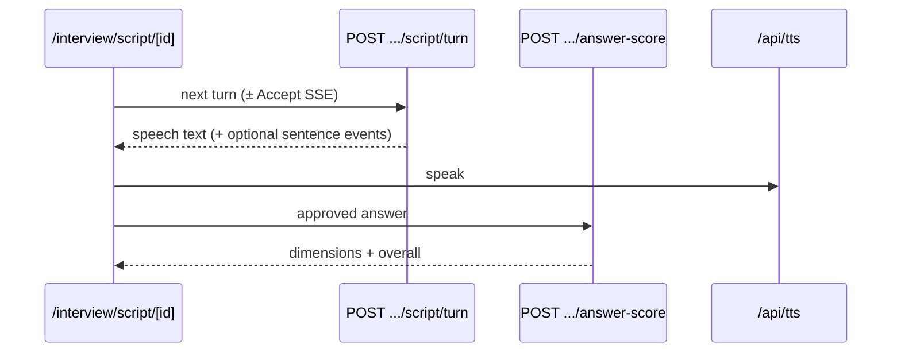

# Interview Engine (V2.1)

> Status: CANONICAL
> Last Verified: 2026-10-05
> Verification Scope: Script engine routes, tables, lifecycle + durable milestones + stale cleanup + resume discoverability + recovery emails + in-route LLM fail-closed RL/cost guards + persisted V2.1 core-question plans (first-turn generation, duplicate-safe fallback)
> Authority: Production interview path

## Purpose

Document the **current** mock-interview engine: V2.1 script engine. Legacy V1 dual-agent is **REMOVED**.

## Current State

| Fact | Value |
|---|---|
| Engine marker | `interviews.engine = 'v2.1'` |
| Entry UI | `/interview/script/start` |
| Start API | `POST /api/interview/script/start` |
| Session UI | `/interview/script/[id]` |
| Scripts | `SCRIPT_H` (behavioral), `SCRIPT_T` (technical), `SCRIPT_M` (mixed) |

### API surface (`/api/interview/script/`)

| Route | Role |
|---|---|
| `start` | Create interview + credit ownership RPC |
| `session` | Load session state |
| `turn` | Next interviewer turn (JSON or SSE first-sentence) |
| `auto-structure` | Live structure assist |
| `answer-score` | Per-answer scoring (`score-v1.6`) |
| `complete` | Finish interview; backfill scores if needed |
| `report` | Script interview report |

### Request input ceilings (server Zod)

Shared schemas: `src/lib/interview/script-turn-request-schema.ts` (`SCRIPT_ANSWER_MAX_CHARS = 12_000`).

| Field | Max chars | Routes |
|---|---|---|
| `lastAnswer` / `sttRawTranscript` / `transcript` / `rawTranscript` | 12_000 | turn, answer-score, auto-structure |
| `displayQuestion` | 2_000 | answer-score, auto-structure |
| `targetRole` | 100 | answer-score, auto-structure |

Oversized bodies → `400` with Zod `fieldErrors` before persistence or LLM calls. Special values `[NONE]` / `[SKIPPED]` / `[TIMEOUT]` remain valid.

### In-route LLM abuse controls (fail-closed)

Independent of proxy IP rate limits. Shared helpers: `src/lib/interview/script-llm-guards.ts` + atomic `reserveLLMCost` in `src/lib/ai/llm-cost-guard.ts`.

| Route | Per-user RL (60s) | Cost op | Notes |
|---|---|---|---|
| `POST .../turn` | 30 | `script_turn_generation` | RL after auth; cost reserve immediately before LLM (JSON + SSE). Canned turns skip cost reserve. |
| `POST .../answer-score` | 20 | `answer_score` | Idempotent same-transcript hits skip LLM + cost reserve. |
| `POST .../auto-structure` | 20 | `auto_structure` | Reserve after ownership, before provider. |
| `GET .../report` | 10 | `script_report_synthesis` | RL on every GET; cost reserve only when synthesis LLM runs (claim owner path). |

**Failure policy (Redis configured):**

| Condition | HTTP | Stable `code` (where set) |
|---|---|---|
| Window exhausted | 429 | (message only; Retry-After via headers) |
| Rate-limit Redis error | 503 | `rate_limit_backend_unavailable` |
| Monthly plan cost exhausted | 429 | `llm_cost_limit_exceeded` |
| Cost Redis error | 503 | `llm_cost_backend_unavailable` |

**Accounting:** atomic incr-then-check reservation before provider; keep on successful provider response (or any raw output); `release()` on transport failure before any provider response. Unconfigured Redis (local DX) remains fail-open — same as `checkRateLimit`. Responses must not expose Redis/provider internals.

Plan budgets: `users.plan_tier` → `getPlanLimits(...).max_llm_cost_per_month_usd` (free `$0.10`, starter `$0.50`, pro `$5`, …).

### Tables

- `interviews` (+ v2.1 columns, `session_context.questionPlanStatus` for new plans)
- `questions` (V2.1 core plan rows when `plan_status` is set; legacy V1 rows stay `plan_status` NULL)
- `script_turns`
- `answer_evaluations`
- `script_interview_reports`
- `resume_interview_snapshots`

### Lifecycle authority + durable analytics

- **Authoritative completion** = `interviews.status = 'completed'` (transactional DB state). Admin COMPLETED counts this — **not** `product_events`.
- On successful V2.1 completion (`completeScriptInterviewFromTurn` and `PATCH .../script/complete`), attempt durable `product_events.interview_completed` via `persistMilestoneEventOnce`. Migration 052 unique index keeps **at most one** durable row per interview when persistence succeeds; a persistence failure can still yield zero rows. Analytics failure must not fail completion.
- Turn-path completion UPDATEs only `status IN ('pending','in_progress')` and emits only when a row actually transitioned — abandoned cannot become completed through that helper.
- On abandon (`POST /api/interview/[id]/abandon`, exit-feedback abandon), attempt durable `interview_abandoned` via fire-and-forget `persistMilestoneEventOnce` (at-most-one durable row when persistence succeeds; delivery is not guaranteed). Abandoned rows must not emit `interview_completed`.
- `completed_at` is a **terminal timestamp** (set on both successful complete and abandon). Do not treat `abandoned.completed_at` as “successful completion” in admin LAST INTERVIEW — prefer `started_at` (see `recent-user-interview-stats.ts`).

### Stale active sessions

- Policy: **45 minutes** since `interview_last_activity_at` (`ACTIVE_INTERVIEW_STALE_AFTER_MS` ↔ migrations 096/108/109).
- Cleanup paths: (1) inside `create_interview_with_credit` on next start (status abandon only — **no** `interview_abandoned` milestone in this path; deferred follow-up); (2) proactive cron `GET /api/cron/abandon-stale-interviews` → RPC `abandon_stale_active_interviews` (V2.1 only, no credit refund, `SKIP LOCKED`). The RPC re-checks the stale predicate on the authoritative UPDATE so a recently active session is not abandoned from a stale candidate set.
- **Cron analytics (migration 109):** RPC returns `(interview_id, user_id)` for each successfully transitioned row. The cron helper awaits `persistMilestoneEventOnceAsync('interview_abandoned', { engine: 'v2.1', source: 'stale_cron', ... })` per returned row. Migration 052 keeps **at most one** durable row per interview when persistence succeeds; delivery is not guaranteed. Analytics failure must not roll back or fail a successful abandonment (HTTP 200 with `milestoneFailures` counted).
- Cron is daily on Vercel Hobby (sub-daily forbidden); start-path cleanup still covers users who begin another interview sooner.

### Active interview navigation policy

While a V2.1 session is **active** (`pending` / `in_progress`, and the session UI has not reached local `completed`):

- Ordinary in-app dashboard navigation (sidebar Links, workspace switcher, logout) is **intercepted**. A blocked attempt does **not** abandon the interview and does **not** emit `interview_abandoned` / `interview_completed`.
- The candidate is directed to the existing **Exit** control → `InterviewExitFeedbackModal` (confirmation + optional reason) → abandon / exit-feedback APIs as today.
- Browser `beforeunload` may prompt on refresh/close while active; unload **must not** be treated as durable lifecycle truth (no abandon/analytics from unload). Stale sessions remain the job of activity/heartbeat + 45-minute cleanup.
- Browser Back/Forward is re-pushed to the session URL and shows the same intercept UX (no history loop after the guard is released on leave/complete).
- After UI completion or intentional leave (guard released), normal navigation works again (including report redirect).

### Candidate resume discoverability (Phase 1)

Presentation-only recovery UX — **does not** rewrite statuses, credits, or completion definitions.

| Candidate-facing state | Badge | CTA | Mechanism |
|---|---|---|---|
| `pending` / `in_progress` | In progress | Continue interview | Open `/interview/script/{id}` directly |
| `abandoned` + `credit_deducted` + `!abandoned_resume_used` | Incomplete | Resume interview | `POST /api/interview/{id}/resume` → `resume_abandoned_interview` (same row, no debit/refund, one shot) |
| `abandoned` ineligible | Ended | — | No resume CTA |
| `completed` | Completed | View report | Existing report routes |

**Deterministic recovery selection** (`fetchPrimaryRecoveryInterview`) — independent of the dashboard recent-list window (limit 20 / slice 5):

1. Newest **active** V2.1 (`pending` \| `in_progress`) by `started_at`
2. Else newest **abandoned** V2.1 with `credit_deducted = true` AND `abandoned_resume_used = false`

Each arm is a bounded `LIMIT 1` query. Completed / ineligible abandoned rows never enter the result set, so they cannot hide an older eligible target.

- Dashboard hero + in-app `interview_reminder` use this helper (notifications page via snapshot).
- Recent interviews UI may still show only the latest rows — recovery CTA does not.
- Explicit Exit / exit-feedback / 45-minute stale policy / nav guard are unchanged.

### Unfinished-interview recovery emails (Phase 2)

Lifecycle reminders complement Phase 1 in-app recovery. **Default off** until product enables `INTERVIEW_RECOVERY_EMAIL_ENABLED=1`.

| Rule | Contract |
|---|---|
| Audience | V2.1 `abandoned` + `credit_deducted` + `!abandoned_resume_used` (same one-continue eligibility as Phase 1) |
| Preference gate | `users.notification_preferences.interviewReminders === true` (default true). Missing prefs fail closed. |
| Global unsubscribe | Suppress when `users.email_digest_unsubscribed === true` **or** `email_preferences.unsubscribed_all === true` (Settings digest flag + legacy PreferenceManager). Unknown digest state fails closed. |
| Recipient | Verified Auth email required |
| Cadence (approved) | Mutually exclusive: `r1` ∈ [24h, 72h); `r2` ∈ [72h, 7d] inclusive; neither before 24h or after 7d. Late first cron ≥72h skips `r1` (no same-day dual send). |
| Scheduler | Daily UTC cron `GET /api/cron/interview-recovery-reminders` (Hobby-safe; after stale-abandon cron). Timing jitter accepted. |
| Idempotency | `lifecycle_email_log` key `interview_recovery:{interviewId}:{r1\|r2}` via claim→confirm/release |
| CTA | Authenticated `/dashboard` (Phase 1 hero/CTA); no interview id in email query params |
| Suppression | Resume used, completed/active, reminders off, global unsub, missing/unverified email, stage not due, already claimed/sent, flag off (non-dry-run) |
| Credits / status | **Never** mutated by reminder processing |
| Dry-run | `?dryRun=1` (or any other dryRun value) is **read-only** and works with the flag **off**. Real sends require flag=`1` **and** absent dryRun param. |
| Batch | Scan up to 200 oldest-in-window rows; at most 40 send attempts/run; already-claimed skips do not consume the send budget |
| Settings copy | Interview reminders describes practice nudges **and** unfinished-interview recovery |

**Stuck / ambiguous claims:** Claim inserts `status=sent` with `error_message=claim_in_progress` before Resend. Crash before provider call leaves that row forever (blocks resend). Provider accept without confirm clears `claim_in_progress` when confirm succeeds; confirm failure may leave `sent` with null/unknown provider id. Schema **cannot** distinguish “never accepted” vs “accepted then crash before confirm”. Do **not** auto-release ambiguous `sent` rows. Ops: inspect `error_message` + `provider_message_id`; manual release only with dual confirmation that Resend has no message.

**Residual race:** Interview/prefs are re-loaded immediately before claim. Race remains between that revalidation and provider acceptance (resume/opt-out in that window can still receive mail). Not atomic with Resend.

`?dryRun=1` reports candidates without Resend. Provider acceptance ≠ delivery; do not attribute `interview_completed` / resume rates to email without separate measurement. Open/click tracking is not claimed.

Disable procedure: unset `INTERVIEW_RECOVERY_EMAIL_ENABLED` (or any value other than `1`). Cron may still run; without dryRun it no-ops when disabled.

### Turn model



- Follow-ups: same LLM call (`is_follow_up: true`), max 2 per parent core, do not consume `question_count` and do not consume a planned core slot
- Answer context recovered so ack auto-advance cannot wipe the real answer
- Optional LLM→TTS SSE gated by `VOICE_LLM_TTS_STREAMING` (unset → JSON-only)

### Core question plan (new V2.1 interviews)

`POST /api/interview/script/start` only writes `session_context.questionPlanStatus = pending`. It does not call the planner, so startup stays on the 30s route budget. The first `POST /api/interview/script/turn` builds and persists the plan, then serves it.

```text
start → pending marker
turn  → candidate pool (~2× question_count) → normalize / dedupe / novelty
      → N planned rows in questions (plan_status = planned)
      → select next planned core → persist the turn → mark asked
      → LLM still writes follow-ups, probes, and the spoken bridge
```

| Rule | Contract |
|---|---|
| Who | Interviews whose `session_context.questionPlanStatus` is `pending` or `ready`. Older rows have no marker and keep the previous turn path, plus a server block on equivalent core repeats. |
| Source of truth | `questions` rows with `plan_status` in `planned` / `asked` / `skipped`. Follow-ups stay on `script_turns` only. |
| SCRIPT_M | Planned rows alternate technical, behavioral, technical, behavioral. Hardcoded templates are a last resort. If every template of the required type was already asked, the turn is an acknowledgment with `is_question: false`. It is not the last template again. |
| Duplicate block | A new core is not saved when it matches an earlier core after normalization, lexical equivalence, same-topic overlap, or a same-competency family (authentication / session). A narrow probe, such as index write performance after an indexing core, stays a follow-up. If no unused planned row or fallback exists, the turn does not persist the duplicate core. |
| Novelty | Recently asked cores, the candidate's earlier interviews, and other interviews' planned-but-unasked cores reduce a question's score. Resume, project, JD, and role raise it. Equal scores break on a stable hash of that candidate's role, skills, projects, and JD. Common concepts are not globally banned. |
| New interview, plan cannot be stored | Missing migration, insert failure, LLM timeout, or invalid JSON does not switch that interview back to an uncontrolled core. The turn uses an in-memory candidate-specific plan that still passes the duplicate guard. Nothing is written to `questions`. The failure is logged as `question_plan_generation_failed`. |
| Partial plan | If every stored row is still `planned` and the count is short, the next ensure fills only the missing slots and does not rewrite the rows already stored. |
| History | Existing `questions` rows are not rewritten. In-progress interviews without a marker are not given a plan mid-session. |
| Timing logs | `question_plan_persisted` includes `latency_ms` and `timings` for pool/LLM, duplicate filtering, novelty, persistence, and total. Resume and JD text are not logged. |

Migration: `113_v21_question_plan.sql`. Applied on staging (`20261005075120`) and production (`20261005075253`). Columns are nullable, so existing `questions` rows stay valid. Only new interviews create plan rows after the application build that writes them is deployed. A new interview that cannot persist a plan uses the in-memory fallback above and does not fall through to an unplanned LLM core.

### Scoring

One LLM call: relevance / content_accuracy / communication_clarity / structure / specificity. Overall in app code. Structure = semantic arc, not keyword match. **Never return null score** — neutral fallback (Invariant #4).

### REMOVED — Legacy V1

| Item | Status |
|---|---|
| Dual-agent (Interviewer + Silent Evaluator) | **REMOVED** |
| `/interview/session/[id]` V1 path + `/api/interview/start|process-answer|…` as production mock | **REMOVED** (historical migrations kept) |
| `/interview/session/[id]/v2` | **REMOVED** — experimental **voice rewrite of V1**, not script v2.1 |
| `NEXT_PUBLIC_INTERVIEW_ENGINE_DEFAULT` | **Retired** — v2.1 is the only engine |
| Legacy `/report/[id]` | May remain for **historical** rows only |

## Architecture / Rules

- Credit start via service-role `create_interview_with_credit` (one active interview / user)
- Degrade dual-agent bookkeeping is gone — script path owns state in `script_turns`
- Voice still uses `micCaptureCoordinator` (Invariant #5)

## Dependencies

[AI_PIPELINES](AI_PIPELINES.md) · [VOICE_PIPELINE](VOICE_PIPELINE.md) · [RESUME_PIPELINE](RESUME_PIPELINE.md) · OpenRouter · credit RPCs · [SEO_AEO_GEO](SEO_AEO_GEO.md) (`product_events` milestones)

## Failure Modes

| Failure | Mitigation |
|---|---|
| Score LLM / parse fail | Neutral dimension defaults; complete still runs |
| Active interview conflict | HTTP 409 from start RPC |
| SSE unsupported / flag off | JSON turn fallback |
| Historical V1 report open | Serve legacy report route if present; do not revive V1 engine |
| Milestone insert fail | Logged; completion/abandon still succeed |

## Verification

- Unit: `src/lib/interview/**`, script API tests, `recent-user-interview-stats`, abandon-stale cron
- Manual: start → turn → score → complete → report on `/interview/script/*`
- Voice: `npm run verify:voice` when mic path touched

## Change Triggers

Script prompt versions · turn/score/complete contracts · `engine` column semantics · new script types · resurrecting any V1 path (forbidden without new DEC) · stale policy / cron · milestone emit sites

## Related Documents

[DECISIONS](DECISIONS.md) · [FLOWS](FLOWS.md) · [BACKEND_SCHEMA](BACKEND_SCHEMA.md) · [ROUTING](ROUTING.md) · [FEATURE_FLAGS](../Operations/FEATURE_FLAGS.md)
