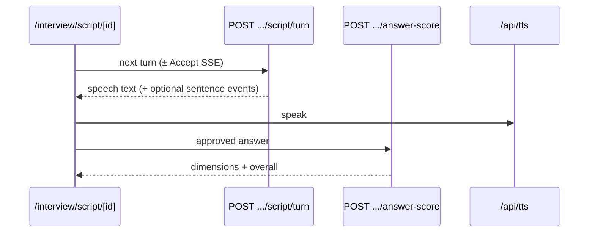

# Interview Engine (V2.1)

> Status: CANONICAL
> Last Verified: 2026-09-27
> Verification Scope: Script engine routes, tables, lifecycle (code reverse-engineering)
> Authority: Production interview path

## Purpose

Document the **current** mock-interview engine: V2.1 script engine. Legacy V1 dual-agent is **REMOVED**.

## Current State

| Fact | Value |
|---|---|
| Engine marker | `interviews.engine = 'v2.1'` |
| Entry UI | `/interview/script/start` |
| Start API | `POST /api/interview/script/start` |
| Session UI | `/interview/script/[id]` |
| Scripts | `SCRIPT_H` (behavioral), `SCRIPT_T` (technical), `SCRIPT_M` (mixed) |

### API surface (`/api/interview/script/`)

| Route | Role |
|---|---|
| `start` | Create interview + credit ownership RPC |
| `session` | Load session state |
| `turn` | Next interviewer turn (JSON or SSE first-sentence) |
| `auto-structure` | Live structure assist |
| `answer-score` | Per-answer scoring (`score-v1.6`) |
| `complete` | Finish interview; backfill scores if needed |
| `report` | Script interview report |

### Tables

- `interviews` (+ v2.1 columns)
- `script_turns`
- `answer_evaluations`
- `script_interview_reports`
- `resume_interview_snapshots`

### Turn model

- Follow-ups: same LLM call (`is_follow_up: true`), max 2 per parent core, do not consume `question_count`
- Answer context recovered so ack auto-advance cannot wipe the real answer
- Optional LLM→TTS SSE gated by `VOICE_LLM_TTS_STREAMING` (unset → JSON-only)

### Scoring

One LLM call: relevance / content_accuracy / communication_clarity / structure / specificity. Overall in app code. Structure = semantic arc, not keyword match. **Never return null score** — neutral fallback (Invariant #4).

### REMOVED — Legacy V1

| Item | Status |
|---|---|
| Dual-agent (Interviewer + Silent Evaluator) | **REMOVED** |
| `/interview/session/[id]` V1 path + `/api/interview/start|process-answer|…` as production mock | **REMOVED** (historical migrations kept) |
| `/interview/session/[id]/v2` | **REMOVED** — experimental **voice rewrite of V1**, not script v2.1 |
| `NEXT_PUBLIC_INTERVIEW_ENGINE_DEFAULT` | **Retired** — v2.1 is the only engine |
| Legacy `/report/[id]` | May remain for **historical** rows only |

## Architecture / Rules

- Credit start via service-role `create_interview_with_credit` (one active interview / user)
- Degrade dual-agent bookkeeping is gone — script path owns state in `script_turns`
- Voice still uses `micCaptureCoordinator` (Invariant #5)

## Dependencies

[AI_PIPELINES](AI_PIPELINES.md) · [VOICE_PIPELINE](VOICE_PIPELINE.md) · [RESUME_PIPELINE](RESUME_PIPELINE.md) · OpenRouter · credit RPCs

## Failure Modes

| Failure | Mitigation |
|---|---|
| Score LLM / parse fail | Neutral dimension defaults; complete still runs |
| Active interview conflict | HTTP 409 from start RPC |
| SSE unsupported / flag off | JSON turn fallback |
| Historical V1 report open | Serve legacy report route if present; do not revive V1 engine |

## Verification

- Unit: `src/lib/interview/**`, script API tests
- Manual: start → turn → score → complete → report on `/interview/script/*`
- Voice: `npm run verify:voice` when mic path touched

## Change Triggers

Script prompt versions · turn/score/complete contracts · `engine` column semantics · new script types · resurrecting any V1 path (forbidden without new DEC)

## Related Documents

[DECISIONS](DECISIONS.md) · [FLOWS](FLOWS.md) · [BACKEND_SCHEMA](BACKEND_SCHEMA.md) · [ROUTING](ROUTING.md) · [FEATURE_FLAGS](../Operations/FEATURE_FLAGS.md)
