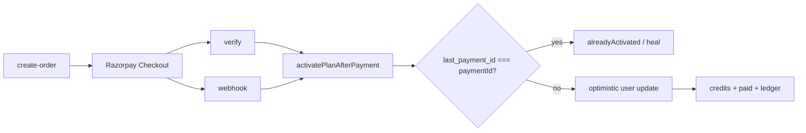

# Payments

> Status: CANONICAL
> Last Verified: 2026-10-15
> Verification Scope: Dual-path activation + Phase 7A recovery (PAYMENTS + PAYMENT_ARCHITECTURE merge) + user-facing billing routes
> Authority: Razorpay plan activation

## Purpose

How paid plans activate safely when verify and webhook race.

## Current State

**Dual-path idempotent activation:** checkout verify and Razorpay webhook both call `activatePlanAfterPayment()`. Whichever wins activates; the other replays safely.

### Critical marker (Invariant #1)

Idempotency = **`users.last_payment_id === paymentId`** — **never** `payments.status` (that conflation caused production incident `pay_T1Xu1KmV48WWzM`).

**Ownership ≠ completeness.** Winning CAS proves entitlement ownership. Local completeness also needs: entitlement snapshot on `payments`, paid binding, one payment-owned ledger row, campaign redemption when present. Replays use service-role `complete_payment_activation_local` — never re-grant credits/tier/expiry or duplicate `payment_completed`.

**Provider validation before ownership.** Fetch Razorpay order/payment; match IDs, amount, **INR**, status to server-owned `payments` row. Campaign orders use frozen `payments.amount`, not live list price.

### Key files

| File | Role |
|---|---|
| `src/lib/razorpay/activate-plan.ts` | SoT activation |
| `provider-payment-validation.ts` | Provider ↔ local contract |
| `api/payments/{create-order,verify,webhook}` | Entry routes |
| `pricing/plans.ts` / `effective-price.ts` | Server amounts + campaigns |
| Migration `088_phase7a_payment_activation_recovery.sql` | Snapshot + replay RPC |

Plans (list / promo floors): starter ₹299 / ₹149 · pro ₹799 / ₹399 — **code is SoT**, not marketing copy.

Credit RPCs / ledger inserts: **service-role-only** (Invariant #2).

### User-facing surfaces

Plan/credits UI (one-time 30-day plans, no auto-renewal) is shared:

| Route | Role |
|---|---|
| `/settings#settings-billing` | Billing section on Settings |
| `/settings/billing` | Dedicated Billing page (Navbar “Billing”; same `BillingUsageCard`) |
| `/upgrade` | Plan grid + checkout |
| `/pricing` | Marketing pricing |

Loader: `src/lib/settings/load-billing-data.ts`. Card: `src/components/settings/BillingUsageCard.tsx`.

## Architecture / Rules

- Client must never supply authoritative `amount` / `price` / `campaignId` for charging
- NULL-safe `last_payment_id` compare (first buyers are NULL; `NULL != x` is unknown in SQL)
- Deploy verify + webhook + activate-plan (+ migration) atomically

## Dependencies

Razorpay · users/payments/credit_transactions · Redis rate limit (fail-closed) · product_events

## Failure Modes

| Mistake | Result |
|---|---|
| Treat `payments.status` as activated | Paid user stuck on Free |
| Treat `last_payment_id` as full completeness | Missing ledger / snapshot |
| Recompute expiry on replay | Accidental extension |
| `!=` without NULL-safe CAS | First purchase races |

## Verification

`npx vitest run src/lib/razorpay/` · manually reason verify-first and webhook-first orderings.

## Change Triggers

Activation CAS · webhook events · plan prices · campaign redemption · credit grant path

## Related Documents

[BACKEND_SCHEMA](BACKEND_SCHEMA.md) · [SECURITY](../Guidelines/SECURITY.md) · archive: `docs/archive/pre-governance-2026-09-27/PAYMENT_ARCHITECTURE.md`
