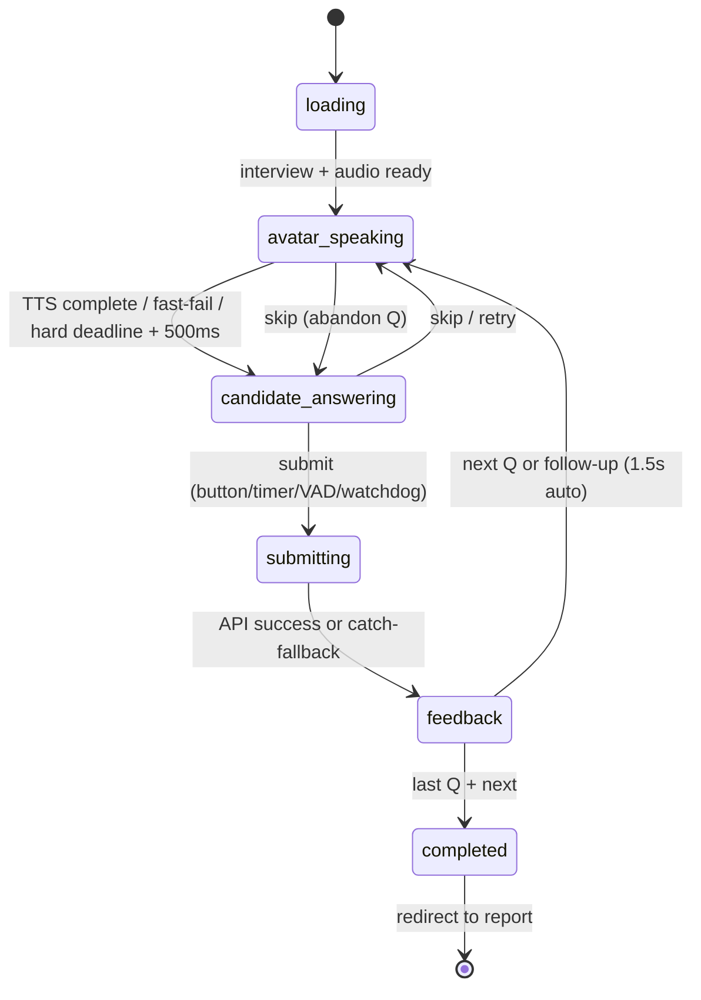
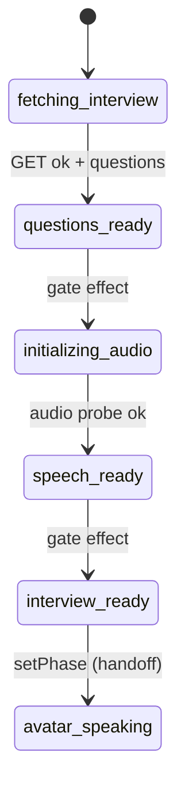
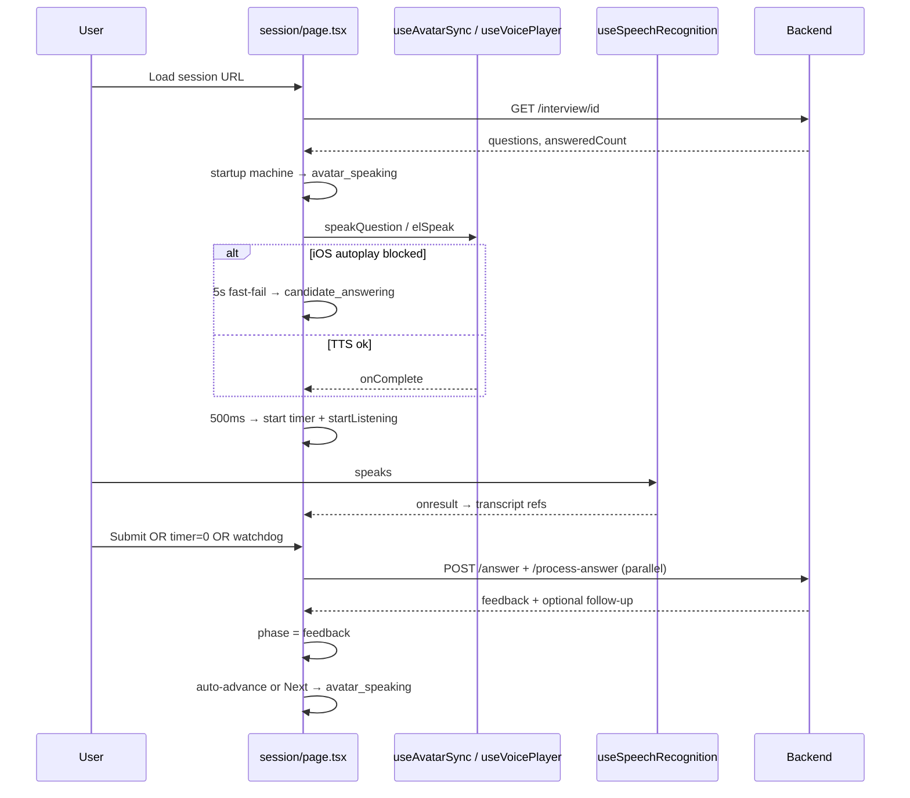
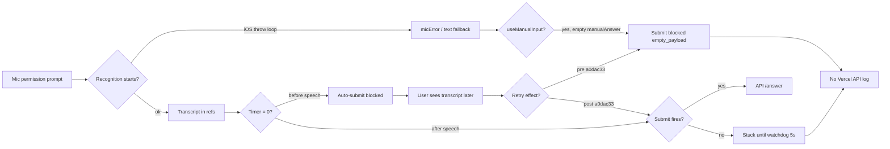

# InterviewEra Mobile Interview Experience — Full Audit Report

**Scope:** End-to-end interview flow on iPhone Safari, iPhone PWA, Android Chrome, Android PWA vs desktop.  
**Method:** Code trace across session page, hooks, APIs, PWA config, and persistence.  
**Goal:** Any user completes a full interview on any listed platform without getting stuck.

---

## Executive Summary (Brutally Honest)

Desktop Chrome/Edge works **most of the time** because gesture tokens, TTS autoplay, and Web Speech are forgiving. Mobile is **architecturally second-class**: the session page is a large client-side state machine with **24+ effects**, **dual nested state machines**, and **no draft persistence**. Server resume only knows **submitted** answers.

Recent fixes (commit `a0dac33`) addressed the highest-impact iOS submit blocker (voice transcript discarded on mic fallback). **That does not make mobile reliable.** Multiple P0/P1 gaps remain: refresh destroys in-progress work, stale-closure watchdogs, no fetch timeouts, fire-and-forget resume parse, prepare poll window vs server timeout mismatch, and no service worker or session recovery layer.

**Honest assessment:** Mobile completion rate will remain below desktop until Phase 9 (refresh safety) and Phase 6 (watchdogs + unified telemetry) are implemented systematically—not as one-off patches.

---

# Phase 1 — Full Flow Audit

## End-to-End Pipeline

```mermaid
flowchart TB
  subgraph PRE["Pre-session"]
    A[Resume Upload<br/>POST /api/resume/upload]
    B[Resume Parse<br/>POST /api/resume/parse]
    C[Status Poll<br/>GET /api/resume/status]
    D[Interview Start<br/>POST /api/interview/start]
    A --> B
    B --> C
    C --> D
  end

  subgraph LOAD["Session load"]
    E[Navigate /interview/session/id]
    F[GET /api/interview/id]
    G{questions ready?}
    H[POST /api/interview/id/prepare]
    I[useInterviewPrepare poll ~58s]
    E --> F --> G
    G -->|no| H --> I --> F
    G -->|yes| J
    I --> J
  end

  subgraph STARTUP["Client startup machine"]
    J[fetching_interview]
    K[questions_ready]
    L[initializing_audio]
    M[speech_ready]
    N[interview_ready → avatar_speaking]
    J --> K --> L --> M --> N
  end

  subgraph QLOOP["Per-question loop"]
    N --> O[avatar_speaking<br/>TTS + avatar]
    O --> P[candidate_answering<br/>timer + mic]
    P --> Q[submitting]
    Q --> R[feedback]
    R -->|follow-up| O
    R -->|next Q| O
    R -->|last Q| S[completed]
  end

  subgraph SUBMIT["Submit path"]
    P --> T[POST /api/interview/answer]
    P --> U[POST /api/interview/process-answer]
    T --> Q
    U --> Q
  end

  subgraph END["Completion"]
    S --> V[POST /api/interview/complete]
    V --> W[aggregateReport]
    W --> X[/report/id]
  end

  D --> E
```

## Runtime State Machine (`SessionPhase`)



## Startup Sub-Machine (`StartupStep`, only while `phase === 'loading'`)



## Event Diagram (Key Transitions)



**Primary file:** `src/app/(dashboard)/interview/session/[id]/page.tsx` (~2,100 lines)

---

# Phase 2 — Mobile Failure Points

## iPhone Safari

| Risk | Location | User Symptom | Severity |
|------|----------|--------------|----------|
| TTS `speechSynthesis` silent after route nav (no gesture) | `page.tsx` fast-fail 5s | Question text shown, no audio; timer still starts | Mitigated (fast-fail) but audio often missing |
| Mic permission consumes gesture token | `useSpeechRecognition` + 5s watchdog | Mic fails → text fallback; contradictory "Listening…" + "Mic unavailable" | Partially mitigated in `a0dac33` |
| `webkitSpeechRecognition.start()` throws synchronously | `useSpeechRecognition.ts` restart storm cap | Frozen UI, stuck mic button (historical) | Mitigated (cap) |
| Interim-only results, session ends before `isFinal` | `onend` cleared interim | Transcript visible then lost on submit | **Fixed in `a0dac33`** (interim promotion) |
| `onend` → idle → auto-restart loop | `useSpeechRecognition.ts` | Brief "Mic off" flicker; state churn | Low–medium |
| Tab background / visibility | `visibilitychange` resume | Mic stops; may not recover without Retry | Medium |
| Safari throttling `setInterval` | `useTimer`, watchdogs | Timer/submit delayed when backgrounded | Medium |
| AudioContext suspended | `useVoicePlayer` | ElevenLabs path silent | Partially mitigated (`resume()`) |
| No `beforeunload` / draft flush | — | Refresh = total loss of current answer | **P0** |

## iPhone PWA (Standalone)

| Risk | Impact |
|------|--------|
| Same as Safari **plus** stricter autoplay/mic gesture rules | Higher TTS/mic failure rate |
| `display: standalone` in manifest; **no service worker** | No offline, no background recovery |
| `start_url: "/"` | Home-screen launch doesn't deep-link to interview |
| Body scroll lock in `DashboardChrome` when drawer open | Orphaned lock → page won't scroll (logged `[scroll-lock]`) |
| No PWA-specific session persistence | Refresh = restart from `answeredCount` |

## Android Chrome

| Risk | Impact |
|------|--------|
| Web Speech engine differs (often better than iOS) | Generally more reliable STT |
| Permission persistence better than iOS | Fewer re-prompts |
| Deepgram path: WebSocket + `getUserMedia` | Extra failure surface (WS drop, token fetch) |
| Chrome ~6 AudioContext limit | Deepgram + TTS + mic can exhaust contexts on long sessions |
| Background tab kills mic/WebSocket | Same as iOS visibility issues |

## Android PWA

| Risk | Impact |
|------|--------|
| Manifest-only install (no SW) | Same as iOS PWA gaps |
| Lifecycle similar to Chrome tab | Slightly better than iOS standalone for media |

---

# Phase 3 — Code Quality Problems

## State Management

| Issue | Detail |
|-------|--------|
| **Dual state machines** | `StartupStep` + `SessionPhase` + derived flags (`webSpeechActive`, `useManualInput`, `dgListening`) — easy to desync |
| **Duplicated transcript sources** | Refs (`getMergedTranscript`), React state (`transcript`/`interimTranscript`), `manualAnswer`, `dgTranscript`, `answerText` display mirror |
| **Conflicting UI signals** | `useManualInput` + `micError` hides voice UI while `isListening` may still be true in control bar |
| **Hidden refs as source of truth** | Submit reads refs; UI reads state — requires careful sync (`syncRender`) |
| **`inputMode` auto-flip** | Effect sets `text` on mic error without always syncing transcript to manual field (partially fixed in `a0dac33`) |

## React Issues

| Issue | File | Risk |
|-------|------|------|
| **Intentionally narrow effect deps** | TTS effect `[phase, currentIndex, pendingFollowUp]` | Stale `inputMode`, tone, interviewer in callbacks |
| **Stale closure in watchdogs** | Mic startup watchdog omits `recognitionState` from deps | False text-mode flip or missed recovery |
| **Duplicate timer submit effects** | Two effects fire at `timeLeft===0` | Redundant submit attempts (guarded by `submitInFlightRef`) |
| **StrictMode remount** | `mountedRef` reset required in load effect | Was a production dev deadlock; pattern repeated in speech hook |
| **24+ useEffects on one page** | `page.tsx` | Interaction bugs extremely hard to reason about |

## Async Issues

| Issue | Impact |
|-------|--------|
| **`api.ts` has no timeout/AbortController** | Mobile hang on dead connections indefinitely |
| **Fire-and-forget resume parse** | `onboarding/page.tsx` — parse may never run |
| **Prepare poll ~58s vs server maxDuration 60s** | False "taking longer" while server still working |
| **Parallel `/answer` + `/process-answer`** | Double LLM load; orchestrator failure silent |
| **`/complete` no explicit maxDuration** | Possible platform timeout on slow retention work |
| **Swallowed orchestrator errors** | `.catch(() => null)` — follow-ups silently skipped |

## UX Issues

| Issue | User Sees |
|-------|-----------|
| Empty submit blocked with warning | "We didn't catch your answer yet" while transcript may appear elsewhere |
| No refresh warning | Accidental refresh loses current Q |
| Exit confirm says progress lost | Accurate — but no draft save |
| `completed` interview not redirected on avatar session load | User can re-enter finished interview via history |
| Loading spinner generic | Startup steps help, but audio failure still confusing on mobile |
| Submit button enabled when phase wrong but has text | Edge case from recent fix — handler still guards on phase |

---

# Phase 4 — Early Return Report

## P0 — Blocks Interview Completion

| Early Return | Condition | User Sees | File |
|--------------|-----------|-----------|------|
| Empty payload guard | `!submittedText` | Amber warning, stuck on same Q | `page.tsx` ~1088 |
| Wrong phase on submit | `phaseRef !== 'candidate_answering'` | Click does nothing (silent) | `page.tsx` ~1063 |
| Timer expired before speech, no retry (pre-fix) | `timeLeft===0` once | Timer 0s, no advance | `page.tsx` timer effects |
| Refresh mid-Q | Full remount | Restarts Q from server index; draft lost | No guard — architectural |
| Resume not parsed | 409 on start | Cannot start interview | `start/route.ts` |

## P1 — Major Mobile Degradation

| Early Return | Condition | User Sees |
|--------------|-----------|-----------|
| Mic startup watchdog | 5s, not active, no transcript | Switches to text mode |
| Restart storm giveup | MAX_RESTARTS exceeded | Error + manual retry |
| TTS fast-fail | No onstart in 5s | No audio, timer starts |
| Prepare poll exhausted | 30 attempts | "Question generation taking longer" |
| Load timeout 15s | Slow network | Error screen |
| `start()` bail `timeLeftRef <= 0` | Timer not restarted after prior Q timeout | Timer stuck at 0 (fixed via ref, fragile) |

## P2 — Silent / Partial Failures

| Early Return | Condition | User Sees |
|--------------|-----------|-----------|
| `submitInFlightRef` duplicate | Double click/timer/VAD | Second attempt ignored |
| Post-await phase changed | Navigated during eval | Response dropped |
| Stale gen in `onresult` | Orphan recognition instance | Transcript dropped |
| VAD wrong phase | `phaseRef !== candidate_answering` | No auto-submit |
| Orchestrator null | process-answer failed | No follow-up (invisible) |

## Legacy Route (`/interview/[id]`)

| Guard | Impact |
|-------|--------|
| 50-char minimum voice submit | `VoiceAnswerInput.tsx` — mobile users with short answers blocked |
| No follow-up orchestration | Different product behavior vs avatar session |

---

# Phase 5 — Production Telemetry (Current vs Required)

## What Exists Today

| Prefix | Status | Notes |
|--------|--------|-------|
| `[interview-startup]` | Always-on | Platform/PWA context, startup transitions |
| `[VOICE]` | Always-on (recent) | mic_permission_granted, speech_started/result/ended |
| `[INTERVIEW]` | Always-on (recent) | submit_clicked/started/success/failed/blocked, advance_question |
| `[INTERVIEW_STUCK_AFTER_TRANSCRIPT]` | Always-on (recent) | Watchdog trigger |
| `[VOICE_DEBUG]` | Opt-in prod (`localStorage.VOICE_DEBUG=1`) | Detailed pipeline |
| `[mic-flow]` | Always-on | Mic lifecycle |
| `[session:lifecycle]` | Always-on | Phase transitions |
| `[scroll-lock]` | Always-on | Drawer scroll lock |

## Gaps vs Requested Schema

Required prefixes **not fully implemented**:

| Prefix | Gap |
|--------|-----|
| `[INTERVIEW_FLOW]` | No unified flow logger with mandatory fields |
| `[TIMER]` | No structured timer start/stop/expiry logs |
| `[SUBMIT]` | Partially covered by `[INTERVIEW]` |
| `[EVALUATION]` | No client-side eval phase logging |
| `[QUESTION_ADVANCE]` | Partially `advance_question` |
| `[REPORT_GENERATION]` | No client complete/report logs |

**Mandatory fields missing from most logs:** `interviewId`, `questionIndex`, `currentPhase` should be on **every** event (currently inconsistent).

**Server-side:** Vercel logs show HTTP status only — no client telemetry pipeline to backend (no `/api/telemetry` or product events for submit failures).

---

# Phase 6 — Resilience System (Current vs Needed)

| Watchdog | Status | Gap |
|----------|--------|-----|
| Transcript → submit (5s) | **Implemented** (`a0dac33`) | Should log to server; may fire duplicate with timer |
| Timer → submit | **Implemented** | One-shot + late-transcript retry |
| Question advance after submit | **Missing** | If `feedback` stuck, no recovery |
| Evaluation stall | **Missing** | `submitting` phase has animated UI only; no timeout |
| Session phase stuck | **Partial** | TTS fast-fail/hard deadline only in `avatar_speaking` |
| Mic stuck escape UI | **Implemented** | 8s silence poll; user must click |
| Prepare/generation | **Partial** | Client poll only; no server push |

---

# Phase 7 — Mobile Performance (Code-Informed Estimates)

No production RUM/metrics in codebase. Bottlenecks from architecture:

| Stage | Typical Risk | Bottleneck |
|-------|--------------|------------|
| Avatar load | Low | Static image + optional video via `useResilientVideo`; `preload="auto"` |
| TTS startup | **High on iOS** | Browser TTS blocked; ElevenLabs adds network + decode |
| Speech startup | **High on iOS** | Permission prompt + recognition start throws |
| Question generation | Medium | LLM 13s budget; client poll 58s |
| Submit latency | Medium–high | Parallel eval 26.5s + orchestrator 55s max |
| Report generation | Low–medium | DB aggregation; complete route no maxDuration |

**Missing:** `performance.mark()` / duration logging at phase boundaries.

---

# Phase 8 — PWA Review

| Area | Finding |
|------|---------|
| **Manifest** | `public/site.webmanifest` — standalone, portrait; deferred inject via `DeferredWebManifest.tsx` |
| **Service worker** | **None** — no next-pwa, no offline |
| **Cache** | Browser default only |
| **Offline** | `OfflineBanner.tsx` — banner only |
| **Storage** | `localStorage`: feedback context + prefs only — **not interview state** |
| **Navigation restoration** | None for in-progress Q |
| **Session restoration** | Server `answeredCount` only |

**Refresh behavior:** Hard refresh → full startup machine rerun; **in-progress transcript, timer, phase, follow-up queue lost**. `storeSessionContext` resets `session_started_at` on every load (breaks feedback duration accuracy).

---

# Phase 9 — Refresh Safety

| Data | Survives Refresh? |
|------|-------------------|
| Submitted answers | Yes (DB) |
| Current question index | Yes (`answeredCount`) |
| In-progress transcript | **No** |
| Phase / timer | **No** |
| Skip count | **No** |
| Pending follow-up | **No** |
| Celebration state | **No** |

**User report "refresh causes restart" is accurate and by design today**, not a bug in routing — it's missing product capability.

---

# Phase 10 — Deliverables

## What Works Correctly (Desktop-Biased)

- Server-side answer persistence and evaluation with fallbacks
- Async question generation with prepare + poll
- Phase machine with TTS fast-fail / hard deadline (prevents infinite `avatar_speaking`)
- Generation-token stale handler protection in Web Speech
- Double-submit guard (`submitInFlightRef`)
- Deepgram path with VAD auto-submit (when WS + mic healthy)
- iOS-specific mitigations documented in code (many added recently)
- Recent submit pipeline fix for voice/manual desync

## What Is Fragile

- Entire session page as monolith state machine
- Mic permission + gesture timing on iOS
- Timer vs speech arrival ordering
- Watchdog stale closures
- Parallel API calls without unified client timeout
- No server-side client event stream

## What Is Broken (or Effectively Broken on Mobile)

- **Refresh mid-interview** (draft loss) — user-visible restart
- **No fetch timeouts** — hung submits on bad mobile networks
- **Fire-and-forget resume parse** — silent parse failure
- **Avatar session doesn't redirect completed interviews** — confusion from history
- **Classic `/interview/[id]` incompatible with async prepare** — 404 if used
- **Conflicting mic UI states** under error + active recognition

## Mobile-Only Issues

1. TTS/autoplay gesture loss after navigation
2. Mic permission consumes gesture → recognition start failures
3. Web Speech interim-only + session end behavior
4. Background tab throttling of timer/watchdogs
5. Safari scroll lock interaction with drawer
6. Virtual keyboard + textarea focus (no `visualViewport` handling on session page)
7. Long vertical layout on small screens — submit bar may require scroll (`min-h-screen` not `dvh`)

## PWA-Only Issues

1. No service worker / offline strategy
2. `start_url` not interview-aware
3. Standalone mode stricter media policies
4. No install-time mic/TTS priming guidance

## State-Management Issues

- 6+ transcript representations
- Derived `useManualInput` fights with live recognition state
- Refs + state duplication for phase and timer

## Architecture Issues

- **Two session UIs** (avatar vs classic) with different capabilities
- **All realtime logic in one 2100-line page** — untestable, high regression risk
- **No client session store** (Zustand/IndexedDB) for crash/refresh recovery
- **No telemetry bus** to backend for mobile debugging in production

---

## Top 10 Highest-Risk Bugs (Ranked)

| # | Bug | P | Platforms |
|---|-----|---|-----------|
| 1 | Refresh loses in-progress answer; no recovery | **P0** | All mobile |
| 2 | `api.fetch` no timeout — submit hangs forever | **P0** | Mobile networks |
| 3 | Mic fallback + voice transcript desync on submit | **P0** | iOS (partially fixed) |
| 4 | Timer expires before speech; advance depends on retry effects | **P1** | iOS |
| 5 | Stale-closure mic startup watchdog flips to text incorrectly | **P1** | iOS PWA |
| 6 | Fire-and-forget resume parse — onboarding stuck | **P1** | All mobile |
| 7 | Prepare poll window < server maxDuration — false failure | **P1** | Slow networks |
| 8 | `submitting` phase no timeout — stuck "Analyzing…" | **P1** | All |
| 9 | Body scroll lock orphan after drawer | **P1** | iOS PWA |
| 10 | No production client telemetry to server — mobile bugs invisible in Vercel | **P1** | All mobile |

---

## Priority Ranking

### P0 — Interview Completion Blockers

- Refresh/draft persistence
- Client fetch timeouts + submit watchdog → force retry UI
- Verify `a0dac33` fix in production iOS; add server-side submit events

### P1 — Major Mobile Issues

- Unified `[INTERVIEW_FLOW]` telemetry with mandatory context fields
- Evaluation phase timeout + auto-advance fallback
- Question advance watchdog after successful submit
- Fix mic startup watchdog stale closure (use refs)
- Await resume parse or surface failure explicitly
- Align prepare poll with server timeout (≥65s)
- `beforeunload` + refresh restore prompt
- Mobile layout: `dvh`, safe-area on control bar, keyboard avoidance

### P2 — Reliability Improvements

- Extract session controller from page.tsx
- Single transcript model
- Server-sent events or WebSocket for generation status
- Redirect completed interviews on session load
- Consolidate timer submit effects
- AudioContext lifecycle management for long sessions

### P3 — Polish

- PWA `start_url`, scope, screenshots
- Service worker for static assets only
- Upload progress + timeout on resume
- Haptic/visual feedback on mic state transitions

---

## Recommended Refactor Plan (Implementation Order)

**Do not start with UI polish.** Proposed sequence:

### Sprint 1 — Observability + Network Hardening (1 week)

1. Add `interviewTelemetry(event, ctx)` — every log includes `interviewId`, `questionIndex`, `phase`, platform, PWA, timestamp
2. Wrap `api.get/post` with 30s/60s AbortController timeouts
3. POST critical client events to `/api/product-events` (submit_blocked, stuck, phase_timeout)
4. Add `[TIMER]` and `[EVALUATION]` phase logs

### Sprint 2 — Session Persistence (1–2 weeks)

1. `sessionStorage` or IndexedDB draft: `{ interviewId, questionIndex, phase, transcript, timerRemaining, skipCount }`
2. Restore on mount before startup machine
3. `beforeunload` prompt when draft exists
4. Flush draft on successful submit

### Sprint 3 — Watchdog Suite (1 week)

1. Phase watchdog: max time in each phase → recovery action
2. Evaluation watchdog: 45s in `submitting` → retry submit or skip with message
3. Question advance watchdog: 10s in `feedback` without transition → force `handleNextQuestion`
4. Fix all watchdog stale closures via refs

### Sprint 4 — Mobile Media Reliability (1–2 weeks)

1. Gesture-aware TTS priming button on first `avatar_speaking` (iOS)
2. Mic permission UX: explicit "Tap to enable microphone" before auto-start
3. Consolidate transcript into single hook/store
4. `visualViewport` scroll-into-view for textarea + submit bar

### Sprint 5 — Architecture (2 weeks)

1. Extract `useInterviewSessionController` from page.tsx
2. Deprecate or align classic `/interview/[id]` route
3. Optional: lightweight service worker for app shell cache only

### Sprint 6 — PWA (1 week)

1. Fix manifest `start_url`, add `scope`
2. Document install + mic permission flow for iOS users
3. Evaluate minimal SW for offline banner + cached static assets

---

## Diagram: Where Mobile Users Get Stuck (Observed Production Pattern)



---

## Bottom Line

The codebase has **substantial mobile-aware defensive coding** (fast-fail TTS, generation tokens, restart storm caps, recent submit fixes). That is not the same as **mobile reliability**. The largest structural gaps are **no draft persistence on refresh**, **no client network timeouts**, **no end-to-end telemetry to the server**, and **too much critical logic in one React page with stale-closure watchdogs**.

Until Sprint 1–3 land, expect continued iPhone/Android reports of "transcript appeared but nothing happened" and "refresh restarted my interview" — even with `a0dac33` deployed.

**Recommended next steps:** Sprint 1 (telemetry + fetch timeouts) and Sprint 2 (draft persistence) — highest ROI for production mobile completion rate.

---

## Key File Index

| Area | Path |
|------|------|
| Session page (primary) | `src/app/(dashboard)/interview/session/[id]/page.tsx` |
| Classic session | `src/app/(dashboard)/interview/[id]/InterviewSession.tsx` |
| Speech recognition | `src/hooks/useSpeechRecognition.ts` |
| Timer | `src/hooks/useTimer.ts` |
| TTS / avatar | `src/hooks/useAvatarSync.ts`, `src/hooks/useTTS.ts` |
| ElevenLabs | `src/hooks/useVoicePlayer.ts` |
| Deepgram mic | `src/hooks/useMicrophone.ts` |
| Question prepare | `src/hooks/useInterviewPrepare.ts` |
| Telemetry | `src/lib/voice/lifecycle-log.ts` |
| API client | `src/services/api.ts` |
| PWA manifest | `public/site.webmanifest` |
| Dashboard chrome | `src/components/layout/DashboardChrome.tsx` |
| Onboarding | `src/app/(dashboard)/onboarding/page.tsx` |
