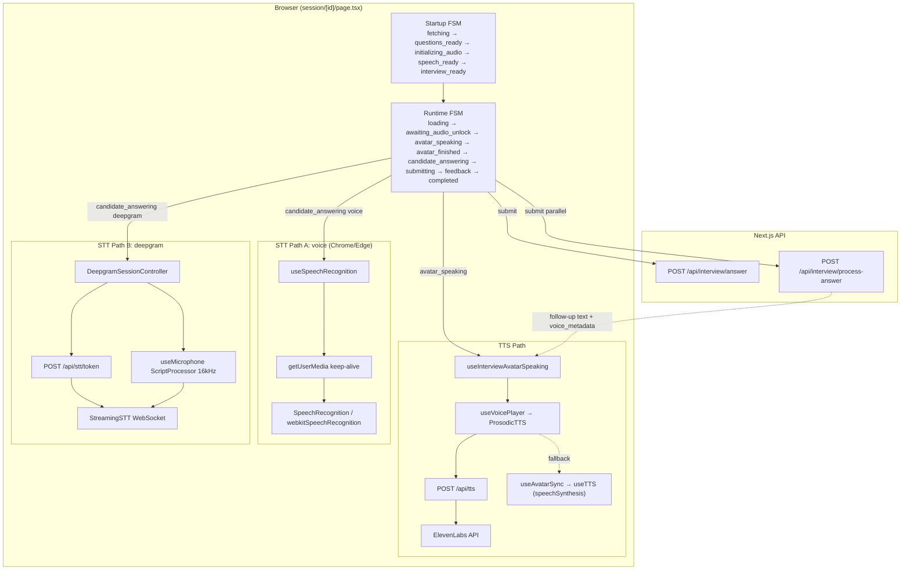
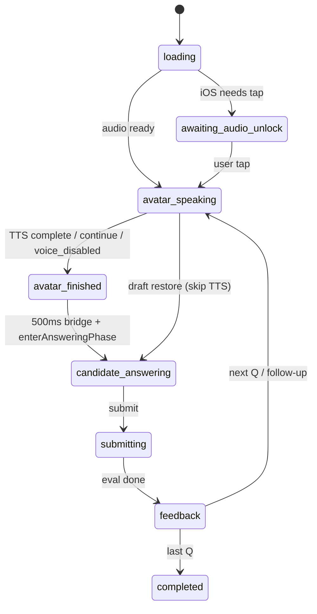

# InterviewEra Voice Pipeline — Engineering Audit Report

**Date:** June 19, 2026  
**Scope:** End-to-end voice interview architecture (audit only — no code changes)  
**Primary surface:** `/interview/session/[id]` (avatar session)

---

## 1. Executive Summary

InterviewEra's **avatar session** (`/interview/session/[id]`) is the production voice surface. It orchestrates **two independent STT engines** (browser Web Speech API on Chrome/Edge, Deepgram Nova-3 WebSocket elsewhere), **two TTS engines** (ElevenLabs via `/api/tts`, Web Speech API fallback), and **four overlapping state machines** inside a ~3,200-line page component.

The reported symptom — repeated **"Connecting…"**, **"Connecting microphone…"**, **"Connecting voice channel…"** after the candidate answers — is **architecturally expected** under the current design, not a single bug. Every question cycle performs a **full mic/STT cold start** after TTS teardown. The UI intentionally withholds **"Listening…"** until `recognitionState === 'active'` (Web Speech) or `dgWsOpen && dgIsRecording` (Deepgram). Users can sit in transitional states for **1–15+ seconds** per turn, especially on Android (480ms audio release delay) and during Deepgram token + WS connect.

**Verdict:** The architecture is **not fundamentally correct** for production at thousands of concurrent interviews. It has been hardened with watchdogs, generation tokens, and telemetry, but the **foundation** — dual STT, god-component orchestration, non-streaming TTS, per-question reconnect, browser-speech dependency — requires a **foundational redesign**, not incremental patches.

| Score | Value | Rationale |
|-------|-------|-----------|
| **Reliability** | **38/100** | Many recovery paths; no deterministic happy path; browser STT as primary |
| **Maintainability** | **25/100** | Monolithic page, 4+ state machines, 50+ effects |
| **Scalability** | **Server 62 / Client 32** | APIs scale; per-client WS + full TTS buffer + ScriptProcessor do not |

---

## 2. Architecture Overview

### Primary flow (avatar session)

```
Onboarding → POST /api/interview/start (credit deduct)
          → GET /api/interview/[id] + optional POST /prepare (LLM questions)
          → /interview/session/[id] (client voice loop)
          → POST /api/interview/complete → /report/[id]
```

**Server** owns: credits, questions, scoring (`/answer`), conversation intelligence (`/process-answer`), TTS proxy, STT token issuance.

**Client** owns: all capture, playback, phase transitions, mic lifecycle, transcript assembly.

### Deprecated path (exclude from future architecture)

Classic **text session** at `/interview/[id]` via `InterviewSession.tsx` — no avatar, no follow-ups, no orchestrator. See [Text Mode Deprecation Inventory](#text-mode-deprecation-inventory).

---

## 3. Current Voice Pipeline Diagram



---

## 4. Complete Dependency Graph

```
page.tsx (orchestrator)
├── useInterviewPrepare → GET /interview/[id], POST /prepare
├── useInterviewSessionController → runtime-phase transitions
├── useInterviewAvatarSpeaking → TTS lifecycle, avatar_finished bridge
│   ├── useAvatarSync → useTTS (browser)
│   └── useVoicePlayer → ProsodicTTS → /api/tts
├── useSpeechRecognition → Web Speech API + getUserMedia keep-alive
├── DeepgramSessionController
│   ├── stt-token → /api/stt/token, /api/stt/release
│   ├── StreamingSTT → Deepgram SDK WebSocket
│   └── useMicrophone → getUserMedia + AudioContext + ScriptProcessor
├── useInterviewMicSession → outer watchdog (Deepgram only)
├── useInterviewVoiceUi → UI label derivation
├── useTimer → answer countdown (informational)
├── useInterviewRecovery → phase stall backstops
├── useInterviewDraft → localStorage refresh recovery
├── useVoiceInterviewRecovery → post-refresh voice banner
├── useInterviewPwaLifecycle → visibility/focus resume
├── useInterviewAudio → iOS gesture unlock
└── useInterviewStartupReliability → startup failure UX

API layer (orthogonal to capture):
  /api/interview/start | answer | process-answer | complete
  /api/tts | /api/stt/token | /api/stt/release
```

---

## 5. File Inventory

| File | Purpose | State ownership | Async ops | Risk |
|------|---------|-----------------|-----------|------|
| `session/[id]/page.tsx` | **God orchestrator** — all phases, submit, DG controller | `phase`, `inputMode`, `currentIndex`, DG state, 30+ refs | Fetch, parallel POST, mic/TTS lifecycle | **Critical** |
| `runtime-phase.ts` | Runtime phase type + helpers | None (pure) | None | Low |
| `useInterviewSessionController.ts` | `goToInterviewerTurn` | None | None | Low |
| `useInterviewAvatarSpeaking.ts` | TTS speak + `avatar_finished` bridge | `spokenText`, `playbackFailed`, `speakAttempt` | `elSpeak`, timers 500ms/8s | **High** |
| `useAvatarSync.ts` | Browser TTS + caption index | `currentWordIndex` | `speechSynthesis` | Medium |
| `useTTS.ts` | Web Speech TTS | `isSpeaking`, `error` | `speak`, voice load | Medium |
| `useVoicePlayer.ts` | ElevenLabs playback | `isPlaying`, `playbackProgress` | fetch, decode, play | **High** |
| `useSpeechRecognition.ts` | Web Speech STT (~1,500 LOC) | `recognitionState`, transcripts, permission | getUserMedia, recognition, 3 watchdogs | **Critical** |
| `useMicrophone.ts` | PCM capture for Deepgram | `isRecording` | getUserMedia, ScriptProcessor | **High** |
| `deepgram-session-controller.ts` | Token, WS, mic, refresh, circuit breaker | Internal session state | token fetch, WS connect, mic | **Critical** |
| `stt-client.ts` | Deepgram StreamingSTT | `gen` token, transcript buffer | WebSocket | **High** |
| `stt-token.ts` | Client token fetch + release | None | POST with retry | Medium |
| `tts-client.ts` | ProsodicTTS browser client | Gate check | fetch /api/tts | Medium |
| `elevenlabs-voices.ts` | Priya/Sia, Arjun/Sagar IDs | None | None | Low |
| `elevenlabs-tts-gate.ts` | Session block after EL failures | sessionStorage | None | Medium |
| `audio-gesture.ts` | Shared AudioContext, iOS unlock, mic release | Module singleton `sharedAudioContext` | suspend/resume delays 140–480ms | **High** |
| `browser-capabilities.ts` | Mode resolution Chrome→voice, FF→deepgram | None | None | **High** |
| `useInterviewMicSession.ts` | Deepgram outer watchdog | `failed`, `restartCount` | 2s interval restart | **High** |
| `useInterviewVoiceUi.ts` | UI phase labels | Derived only | None | Medium |
| `useInterviewRecovery.ts` | Stuck phase backstops | None | 45s/8s/72s timeouts | Medium |
| `useInterviewDraft.ts` | localStorage draft | None | localStorage | Low |
| `useVoiceInterviewRecovery.ts` | Refresh voice resume | Recovery FSM | None | Medium |
| `useInterviewPwaLifecycle.ts` | Tab visibility | None | focus/visibility listeners | Medium |
| `CandidateTranscript.tsx` | Web Speech transcript UI | None | None | Low |
| `DeepgramVoiceStatusBanner.tsx` | DG connection status | None | None | Low |
| `api/tts/route.ts` | ElevenLabs proxy | None | 12s upstream, quota | Medium |
| `api/stt/token/route.ts` | Ephemeral DG key + lease | Redis lease | Deepgram Manage API | **High** |
| `api/interview/answer/route.ts` | Scoring + persist | DB | LLM evaluate | Medium |
| `api/interview/process-answer/route.ts` | Follow-up generation | `conversation_states` | LLM orchestrator | Medium |
| **Deprecated text** | | | | |
| `InterviewSession.tsx` | Classic text loop | `SessionState` | /answer only | Remove |
| `VoiceAnswerInput.tsx` | Web Speech in classic | Own `useSpeechRecognition` | Same as voice | Remove |
| `interview/[id]/page.tsx` | Classic route SSR | Server | DB direct | Remove |
| `VoiceInterviewSession.tsx` | Unused DG demo | Local | Not routed | Remove |

---

## 6. State Machine Analysis

### 6.1 Runtime Phase (`RuntimePhase`)



| State | Entry | Exit | Issues |
|-------|-------|------|--------|
| `loading` | Mount | `interview_ready` handoff | StrictMode required `mountedRef` reset (line 689) |
| `avatar_speaking` | `goToInterviewerTurn` | `finishAuthorized` → `avatar_finished` | TTS failure does **not** auto-advance timer |
| `avatar_finished` | 500ms bridge only | `enterAnsweringPhase` | **Rejected** if wrong reason or wrong phase |
| `candidate_answering` | Mic start synchronous in callback | `submitting` | Mic cold start every turn |
| `submitting` | `submitInFlightRef=true` | `feedback` | 45s watchdog exists |
| `feedback` | Eval result | Next or complete | Follow-up auto-advance 1.5s |

**Invalid/missing transitions:**

- No explicit `error` runtime phase — errors are UI overlays
- `goToAnsweringFromAvatarFinished` in controller is **unused**; page uses `enterAnsweringPhase` directly
- Submit during `avatar_speaking` blocked only by phase check, not centralized FSM guard

### 6.2 Startup Phase (`StartupStep`)

```
fetching_interview → questions_ready → initializing_audio → speech_ready → interview_ready → runtime
```

Held in `initializing_audio` on `audioInitError` until user retries.

### 6.3 Speech Recognition (`idle | starting | active`)

From `src/hooks/useSpeechRecognition.ts`:

- **`idle`** — no recognition session running
- **`starting`** — `recognition.start()` called; `onstart` may have fired but **no transcript event yet**
- **`active`** — at least one interim or final transcript received; **only state allowed to show "Listening…"**

**Dead zone:** `starting` + `onstart` can persist **4–12+ seconds** (stall recovery at 4s armed / 12s default).

### 6.4 Deepgram Connection (`VoiceConnectionState`)

```
idle → connecting → connected | retrying | reconnecting | circuit_open | unavailable
```

Token refresh (`scheduleTokenRefresh`) **stops and restarts** entire session mid-answer if answer exceeds ~95s.

### 6.5 Voice UI Phase (`VoiceUiPhase`)

Derived in `useInterviewVoiceUi` — **not** authoritative; can disagree with `CandidateTranscript` and page inline copy.

---

## 7. Race Condition Report

| # | Race | How it happens | Severity |
|---|------|----------------|----------|
| R1 | **Per-question mic cold start** | `handleSubmitAnswer` calls `stopListening` + `stopDgListening`; next turn `enterAnsweringPhase` restarts full pipeline | **Critical** — root UX symptom |
| R2 | **inputMode oscillation** | Effect flips `deepgram↔voice` on capability changes; separate effect tears down DG when preferred is voice | **High** |
| R3 | **Dual timer arm** | `armAnswerTimer('web_speech_active')` requires `active`; `armAnswerTimer('web_speech_onstart')` arms on `isListening` only — timer can run while UI shows "Connecting…" | **High** |
| R4 | **Bootstrap retry flapping** | 1.5s/4s `attemptBootstrap` may `stopListening('bootstrap_stuck_starting')` + restart during legitimate `starting` | **High** |
| R5 | **Overlapping `startListening`** | Guarded by `startInFlightRef` but bootstrap + user tap + watchdog can queue | **Medium** |
| R6 | **Orphaned SpeechRecognition handlers** | Mitigated by `generationRef` | Mitigated |
| R7 | **Deepgram `onFinal` + button submit** | `submitInFlightRef` blocks duplicate | Mitigated |
| R8 | **Token refresh mid-answer** | `scheduleTokenRefresh` → `stop` → `onRefreshRestart` → full reconnect | **High** for long answers |
| R9 | **ElevenLabs + mic contention** | `releaseAudioForMicCapture` 480ms Android delay; TTS may still hold AudioContext | **High** on Android |
| R10 | **Fatal DG error → Web Speech fallback** | `onFatalError` switches to voice + `startListening` while user may be in deepgram mode mentally | **Medium** |
| R11 | **Parallel eval + orchestrator** | `Promise.all` — orchestrator failure doesn't block scoring; follow-up may be lost silently | **Medium** |
| R12 | **StrictMode remount** | `mountedRef`, `useVoicePlayer` reset patterns; load effect has explicit fix | Mitigated in dev |
| R13 | **Stale `enterAnsweringPhase`** | Guard `phaseRef !== 'avatar_finished'` — skipped if phase advanced | **Medium** |
| R14 | **Mic keep-alive vs Web Speech** | Keep-alive stream released before `recognition.start()` — permission re-prompt risk | **Medium** |
| R15 | **Transcript watchdog auto-submit** | 5s after transcript change may submit before user finishes | **Low–Medium** |

---

## 8. Browser Dependency Report

| API | Usage | Reliability risk |
|-----|-------|------------------|
| `SpeechRecognition` / `webkitSpeechRecognition` | **Primary STT on Chrome/Edge** | **Critical** — undocumented, vendor-specific, no SLA, silent failures, `no-speech` storms |
| `speechSynthesis` | TTS fallback + startup probe | **High** — voice list async, iOS gesture, interrupted by mic |
| `getUserMedia` | Permission + Deepgram PCM + keep-alive | **High** — NotReadableError, tab mute, device switch |
| `AudioContext` (×2) | Shared (TTS) + per-session (mic 16kHz) | **High** — Chrome limit ~6, suspend on Android |
| `ScriptProcessorNode` | Deepgram PCM | **Critical** — deprecated, main-thread, GC pressure |
| `Permissions API` | Mic state | **Medium** — unsupported on some WebViews |
| Page Visibility / focus | PWA lifecycle, timer throttle | **High** on iOS background |
| Autoplay policy | iOS `needsAudioGestureUnlock` | **High** |
| `sessionStorage` | ElevenLabs gate | Low |

**Conclusion:** Production reliability **depends on browser-specific speech recognition** on the majority of users (Chrome/Edge). This is architecturally unsound for a voice-first product at scale.

---

## 9. ElevenLabs Integration Audit

| Aspect | Current behavior | Gap |
|--------|------------------|-----|
| Voices | Priya→Sia (`W7iR5kTNHozpIl2Jqq15`), Arjun→Sagar (`Qc0h5B5Mqs8oaH4sFZ9X`) | Correct per `elevenlabs-voices.ts` |
| Mode | **Non-streaming** — full MP3 buffer via `/api/tts` | Latency = network + decode + play; no time-to-first-byte optimization |
| Model | `eleven_multilingual_v2` default; telemetry logs `eleven_turbo_v2_5` | **Mismatch** — observability drift |
| Queue | None — `seqRef` supersession only | No interrupt/barge-in for follow-ups |
| Retry | None server-side; client gate blocks repeat calls | No exponential backoff per project AI pattern |
| Captions | RAF progress × word count (no word boundaries) | Lip-sync/captions approximate |
| Caching | None | Repeated intro patterns re-fetch |
| Connection reuse | New HTTP request per utterance | No HTTP/2 multiplex benefit exploited |
| Interrupt | `stop()` aborts fetch + source | Adequate for question transitions |
| Quota | Redis monthly + per-interview char limit | Falls back to browser TTS |

**Utilization:** ~30% of ElevenLabs streaming/low-latency capabilities. Architecture treats TTS as **batch download**, not a **real-time conversational channel**.

---

## 10. Conversation Flow Analysis

```
Greeting/Q (TTS) → [480ms Android audio release] → Mic connect → STT active → Transcript
    → Parallel: /answer (score) + /process-answer (follow-up?)
    → feedback → [1.5s if follow-up] → TTS follow-up OR next Q
    → REPEAT full mic cold start
```

| Stage | Typical latency | Failure points |
|-------|-----------------|----------------|
| ElevenLabs TTS | 0.5–3s + decode | 429, autoplay block, iOS gesture |
| Audio release → mic | 140–480ms + permission | Android audio focus |
| Web Speech → active | 0.5–12s | Stuck in `starting` |
| Deepgram connect | 1–4s token + WS + mic | Quota, lease, 429 |
| LLM eval | 3–20s | Timeout → fallback feedback |
| Follow-up | Same TTS+mic cycle | Lost if orchestrator fails |

**Synchronization:** No single clock authority. Timer, TTS completion, mic readiness, and eval completion are **independent** — causes "waiting after answering" when `submitting` hangs (mitigated by 45s watchdog) or when user expects mic to already be live after TTS.

---

## 11. Error Recovery Analysis

| Failure | Recovery path | Deterministic? |
|---------|---------------|----------------|
| Network on /answer | Catch → fallback feedback phase | **Partial** |
| Orchestrator timeout | 55s abort; may proceed without follow-up | **Partial** |
| Eval 45s stall | `useInterviewRecovery` forces feedback | **Yes** |
| Mic permission denied | Flip to `text` mode | **Yes** but deprecated path |
| Web Speech stuck | Bootstrap retry, silent recovery, manual retry | **No** — multiple competing recoveries |
| Deepgram quota | `text_mode` fallback | **Yes** → text |
| TTS failure | Browser fallback or "Continue without audio" | **Partial** |
| Tab background | Timer backstop 72s; mic may die | **Partial** |
| Browser refresh | Draft + voice recovery banner | **Partial** — iOS loses audio gesture |
| Half-finished TTS on navigate | Unmount cleanup in hooks | **Mostly** |
| LLM failure on follow-up | Template fallback in orchestrator | **Yes** (server) |

---

## 12. Performance Analysis

| Area | Issue |
|------|-------|
| TTS | Full MP3 in memory per question; no streaming |
| STT | ScriptProcessor on main thread — CPU spikes with long answers |
| Page | 50+ `useEffect` — render churn propagates to mic effects |
| Decode | `decodeAudioData` blocks main thread |
| Watchdogs | 2s mic poll + 2s speech poll + multiple timeouts — battery impact mobile |

---

## 13. Scalability Analysis

| Scale | Server | Client voice |
|-------|--------|--------------|
| 10 | Fine | Fine |
| 100 | Fine; STT token rate limits per user | Occasional DG quota |
| 1,000 | STT lease concurrency per user; ElevenLabs rate | WS connection count to Deepgram |
| 10,000 | **Bottleneck:** `/api/stt/token`, `/api/tts`, Deepgram project limits, Redis leases | **Not viable** with per-session browser complexity |

**Leaks:** Generation tokens and cleanup patterns are good; risk remains in orphaned `AudioContext` if cleanup throws, and DG lease if `pagehide` beacon fails.

---

## 14. Security Findings

| Finding | Severity | Detail |
|---------|----------|--------|
| ElevenLabs key server-only | ✅ Good | `/api/tts` proxy |
| Deepgram key ephemeral 120s | ✅ Good | `/api/stt/token` |
| STT auth + interview ownership | ✅ Good | 403 on wrong user |
| Abuse gate + rate limits | ✅ Good | IP + user limits |
| Transcript in localStorage draft | **Medium** | Unencrypted client storage |
| No transcript E2E encryption | **Low** | Expected for MVP |
| WebSocket auth | ✅ Token in WS header server-issued |
| `process-answer` loose typing | **Low** | No Zod — injection limited |

---

## 15. UX Findings → Root Causes

| Symptom | Architectural root cause | Code anchor |
|---------|--------------------------|-------------|
| **"Connecting microphone…"** after answer | Full mic teardown on submit; re-enter `starting` until first `onresult` | `useInterviewVoiceUi` lines 159–170; `enterAnsweringPhase` |
| **"Connecting voice channel…"** | Full DG reconnect: token → WS → mic every turn | `deepgram-session-controller`; submit stops DG |
| **"Initializing…"** | Startup sub-FSM `initializing_audio` probe | `page.tsx` startup probe effect |
| **Waiting after answering** | `submitting` until `Promise.all` completes; was unbounded (now 45s watchdog) | parallel submit + `useInterviewRecovery` |
| **Silent interviewer** | ElevenLabs fail + browser TTS blocked; iOS no gesture | `useInterviewAvatarSpeaking` |
| **Missing follow-up** | Orchestrator error swallowed in parallel path | submit catch sets feedback without follow-up |
| **Duplicate speech** | ElevenLabs fail triggers **both** browser fallback AND error UI | `onPlaybackFailed` calls `browserFallback()` unconditionally |
| **Audio overlap** | `releaseAudioForMicCapture` async delay; TTS stop best-effort | `audio-gesture.ts` |

---

## 16. Reliability Score

**38 / 100**

---

## 17. Maintainability Score

**25 / 100**

---

## 18. Scalability Score

| Layer | Score |
|-------|-------|
| Server APIs | **62 / 100** |
| Client voice pipeline | **32 / 100** |

---

## 19. Risk Matrix

| ID | Issue | Level |
|----|-------|-------|
| C1 | Browser Web Speech as primary STT | **Critical** |
| C2 | God-component orchestration (`page.tsx`) | **Critical** |
| C3 | Per-question full mic/STT reconnect | **Critical** |
| H1 | Dual STT with mode switching | **High** |
| H2 | Non-streaming TTS latency | **High** |
| H3 | ScriptProcessor / main-thread audio | **High** |
| H4 | Competing audio contexts | **High** |
| H5 | Timer arms before UI shows Listening | **High** |
| M1 | ElevenLabs telemetry model mismatch | **Medium** |
| M2 | Token refresh mid-session | **Medium** |
| L1 | Unused `VoiceInterviewSession.tsx` | **Low** |

---

## 20. Prioritized List of Issues

1. **Eliminate Web Speech as primary STT** — single cloud STT path (Deepgram or successor)
2. **Extract VoiceSessionOrchestrator** — one FSM, one mic owner, one TTS owner
3. **Persistent mic session across questions** — pause/resume, don't teardown on submit
4. **Streaming TTS** — ElevenLabs streaming or WebSocket TTS with prefetch
5. **Decompose `page.tsx`** — max 300 LOC coordinator + injected services
6. **Remove inputMode auto-flip effects** — explicit user choice only
7. **Replace ScriptProcessor** with AudioWorklet
8. **Unify UI state machine** — single `VoiceSessionPhase` drives all labels
9. **Remove text mode** (per product direction)
10. **Server-side session state** for reconnect (optional Phase 2)

---

## 21. Root Cause Analysis — Critical Issues

### C1: "Connecting…" after every answer

**Chain:** `handleSubmitAnswer` → `stopListening` + `stopDgListening` → `feedback` → `handleNextQuestion` → `goToInterviewerTurn` → TTS → `avatar_finished` → `enterAnsweringPhase` → `startListening()` / `startDgListening()` → UI enters `starting` / `connecting` until STT pipeline confirms.

**Why it feels broken:** Users interpret post-answer delay as **stall**; architecture treats it as **normal reconnect**.

### C2: God component

**Chain:** ~3,200 lines, 13 hooks, 4 FSMs, forward refs (`handleSubmitAnswerRef`, `startDgListeningRef`) to break TDZ — classic sign of **missing domain layer**.

### C3: Dual STT

**Chain:** `resolvePreferredVoiceInputMode()` returns `voice` on Chrome → Web Speech with known `no-speech` / `starting` stalls → fallback to Deepgram mid-session → mode flip tears down streams.

---

## 22. Technical Debt Assessment

| Category | Debt level |
|----------|------------|
| Orchestration | **Severe** |
| Test coverage | Moderate (gate tests, integration tests; no E2E voice) |
| Observability | Good telemetry hooks; fragmented across console + beacon |
| Type safety | Good in hooks; loose on orchestrator fetch bodies |
| Documentation | `runtime-phase.ts` well documented; page poorly bounded |

---

## 23. Production Readiness Assessment

| Dimension | Ready? |
|-----------|--------|
| MVP / hundreds of users | **Marginal** — with support load |
| Thousands concurrent | **No** |
| Voice-first SLA | **No** |
| Mobile Android | **High failure rate expected** |
| iOS | **Gesture + background fragile** |

---

## 24. Refactor Readiness Assessment

**Recommendation: Foundational redesign required.** Incremental improvement can reduce incident rate ~20–30% but cannot fix per-turn reconnect or browser STT dependency.

### Guiding principles (no implementation in this phase)

1. **Single STT provider** — cloud streaming only; browser STT = dev fallback only
2. **Single audio session** — one `AudioSession` owns mic, ducking, TTS interrupt
3. **Explicit FSM** — one reducer/state machine; illegal transitions impossible
4. **Streaming-first TTS** — target <300ms time-to-first-audio
5. **Mic lifecycle decoupled from question lifecycle** — pause for TTS, resume for answer
6. **Server-authoritative turn state** — optional for reconnect
7. **No mode auto-flip** — user opts into fallbacks
8. **Delete text mode** from avatar session

---

## Text Mode Deprecation Inventory

Remove in refactor:

| Location | Dependency |
|----------|------------|
| `page.tsx` | `inputMode === 'text'`, `useManualInput`, `manualAnswer`, `TEXT_ANSWER_TIME_MULTIPLIER`, typing fallbacks |
| `useInterviewVoiceUi.ts` | Text branch |
| `useInterviewMicSession.ts` | `inputMode === 'text'` skip |
| `useInterviewStartupReliability` | `onSwitchToTyping` |
| `browser-capabilities.ts` | `text` recommended mode |
| `api/stt/token` | `fallback: 'text_mode'` |
| `DeepgramVoiceStatusBanner` | `onSwitchToText` |
| `interview-draft.ts` | `inputMode: 'text'` persistence |
| `voice-recovery.ts` | `dismissToTyping` |
| `/interview/[id]/*` | `InterviewSession.tsx`, `VoiceAnswerInput.tsx` entire route |
| `VoiceInterviewSession.tsx` | Orphan component |
| `app.types.ts` | `AnswerMode 'text'` — keep DB enum, stop client path |
| Help/marketing copy | References to Type mode |

---

## 25. Final Engineering Verdict

InterviewEra's voice pipeline is a **heavily patched research prototype** pressed into production shape. The team has invested seriously in watchdogs, generation tokens, telemetry, and tri-state mic UI — but these are **compensating controls** for an architecture that:

- Treats **each answer turn as a new voice session**
- Uses **non-deterministic browser STT** as the default on most users
- Splits authority across **four state machines** in one React page
- Delivers TTS as **batch HTTP** while competing for **audio focus** with capture

The **"Connecting…" loop after answering is not a bug to patch** — it is the **designed consequence** of teardown-and-rebuild plus conservative "Listening" gating. Fixing the user experience requires **redesigning the turn transition** so mic/STT stays warm (or shows a single deterministic "Preparing your turn" state with bounded SLA), and **consolidating STT/TTS under one orchestrator**.

| Metric | Score |
|--------|-------|
| Reliability | **38 / 100** |
| Maintainability | **25 / 100** |
| Scalability (client) | **32 / 100** |

Proceed to refactor phase with this document as the authoritative blueprint.

---

*Audit phase complete. No code was modified during this assessment.*
