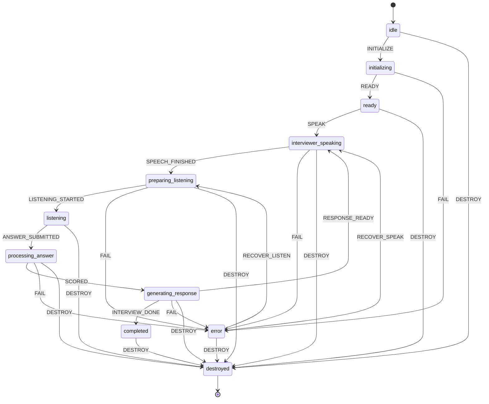

# InterviewEra Voice Pipeline — Refactor Architecture & Migration Plan

**Status:** Living document. Source of truth = `docs/voice-pipeline-architecture-audit.md`.
**Product direction:** Voice-first only. Text Mode removed. Preserve follow-ups, scoring, reporting, conversation flow.

---

## 1. New Architecture (target)

Layered, single-owner, event-driven. React becomes a **thin view** over a framework-agnostic core.

```
┌───────────────────────────────────────────────────────────────┐
│ VIEW (React)                                                    │
│  session/[id]/page.tsx  → renders from a single VoiceSession    │
│  snapshot; dispatches intents (submit, retry, mute). No timers, │
│  no getUserMedia, no TTS, no STT here.                          │
└───────────────▲───────────────────────────┬───────────────────┘
                │ snapshot (useSyncExternalStore)
                │ intents (submit/retry/skip/mute)
┌───────────────┴───────────────────────────▼───────────────────┐
│ ORCHESTRATION (framework-agnostic)                              │
│  VoiceSessionOrchestrator  ── single owner of the session       │
│   ├─ VoiceSessionStateMachine   (one deterministic FSM)         │
│   ├─ EventBus                   (typed, correlated)             │
│   ├─ TurnContext                (sessionId/turnId/correlationId)│
│   └─ Observability              (structured, attributed logs)   │
└───┬───────────────┬───────────────┬───────────────┬────────────┘
    │               │               │               │
┌───▼──────┐  ┌─────▼──────┐  ┌─────▼──────┐  ┌─────▼───────────┐
│ Audio    │  │ STT        │  │ TTS        │  │ Conversation    │
│ Session  │  │ Pipeline   │  │ Pipeline   │  │ Engine          │
│ Manager  │  │ (Deepgram) │  │ (11Labs)   │  │ (answer/process │
│          │  │            │  │            │  │ /complete)      │
└──────────┘  └────────────┘  └────────────┘  └─────────────────┘
   owns           owns            owns             owns
 AudioContext   1 WebSocket    playback queue    HTTP fetches +
 MediaStream    1 PCM tap      streaming audio   AbortControllers
 audio focus    transcript     instant cancel    follow-up logic
```

**One owner per resource** (Phase 1 / Success Criteria):

| Resource | Sole owner |
|----------|-----------|
| AudioContext, MediaStream, audio focus | `AudioSessionManager` |
| Microphone PCM tap | `AudioSessionManager` (vended to STT) |
| STT WebSocket + transcript assembly | `SttPipeline` |
| TTS network + playback queue | `TtsPipeline` |
| Timers, turn flow, cleanup | `VoiceSessionOrchestrator` |
| FSM state | `VoiceSessionStateMachine` |
| Conversation/LLM calls | `ConversationEngine` |

---

## 2. Updated Module Structure

```
src/lib/voice/core/            ← NEW framework-agnostic core (Milestone 1)
  ids.ts                       sessionId / turnId / correlationId
  session-state.ts             FSM states, events, transition table (pure)
  state-machine.ts             VoiceSessionStateMachine (stateful, logged)
  event-bus.ts                 typed EventBus + envelope
  observability.ts             structured attributed logger

src/lib/voice/audio/           ← Milestone 2
  audio-session-manager.ts     AudioContext/MediaStream/playback/mic/focus

src/lib/voice/stt/             ← Milestone 3
  stt-pipeline.ts              single streaming STT (Deepgram primary)
  browser-stt-fallback.ts      explicit emergency-only adapter

src/lib/voice/tts/             ← Milestone 4
  tts-pipeline.ts              ElevenLabs streaming + playback queue + cancel

src/lib/voice/conversation/    ← Milestone 6
  conversation-engine.ts       answer + process-answer + complete adapter

src/lib/voice/orchestrator/    ← Milestone 5
  voice-session-orchestrator.ts  single owner; wires everything

src/hooks/useVoiceSession.ts   ← Milestone 7 (thin React binding)
```

Legacy modules deleted at Milestone 7–8 (see file-by-file plan).

---

## 3. State Machine (Phase 2)

One FSM. Illegal transitions impossible. Every transition explicit, logged, timeout-guarded, cancelable.



- `DESTROY` is legal from every non-terminal state (navigation/unmount safe).
- `error` is recoverable; orchestrator decides `RECOVER_LISTEN` vs `RECOVER_SPEAK`.
- Each transition carries a `TurnContext` and is emitted on the bus + logged.

---

## 4. Audio Session Manager (Phase 6) — design

Single instance per interview. Created once at `initializing`, disposed once at `destroyed`.

Responsibilities: own one shared `AudioContext`; own one `MediaStream`; expose a **PCM tap** for STT and a **playback sink** for TTS; manage audio focus (suspend during capture on Android, resume for playback); iOS gesture unlock; idempotent `dispose()`.

Lifecycle: `create → initialize → active → (pause/resume)* → dispose`. Mic is **acquired once** and kept; `pause()`/`resume()` toggle the tap — never re-`getUserMedia` between questions (Phase 3 + Success Criteria).

---

## 5. Voice Session Orchestrator (Phase 1/5) — design

The only object that mutates session state. Holds: FSM, bus, `AudioSessionManager`, `SttPipeline`, `TtsPipeline`, `ConversationEngine`, timers, `AbortController`s. Exposes an immutable **snapshot** (for `useSyncExternalStore`) and **intents** (`submit`, `retry`, `skip`, `mute`, `continueWithoutAudio`). Per-transition timeout + cancellation. One `dispose()` tears down all resources deterministically.

---

## 6. Event Bus (Phase 7) — design

Typed pub/sub. Envelope: `{ type, sessionId, turnId, correlationId, timestamp, payload }`. Events: `InterviewStarted, QuestionGenerated, QuestionPlaying, QuestionFinished, ListeningStarted, SpeechDetected, TranscriptUpdated, TranscriptFinalized, AnswerSubmitted, LLMStarted, LLMCompleted, PlaybackStarted, PlaybackCompleted, InterviewCompleted, InterviewDestroyed`, plus internal `StateTransition, ResourceLifecycle, Error`. Synchronous dispatch, listener errors isolated, unsubscribe returns from `on()`.

---

## 7. STT Pipeline (Phase 4) — design

One streaming engine. **Deepgram = production primary.** Browser Web Speech retained only as an **explicit emergency fallback** behind a feature flag, never auto-selected. Invariant: **at most one active STT engine**. Persistent WS across questions; `pause()`/`resume()` gate audio frames; transcript assembled with dedupe; generation token drops stale frames.

---

## 8. ElevenLabs TTS Pipeline (Phase 5) — design

Streaming-first. Playback **queue** with single active item; `enqueue()` supersedes prior via sequence + cancels in-flight fetch/source. Voices: Priya→**Sia**, Arjun→**Sagar** (unchanged IDs). Connection reuse via keep-alive fetch; instant cancel via `AbortController` + `source.stop()`; never overlaps capture (coordinated through `AudioSessionManager` focus).

---

## 9. Conversation Engine (Phase 6) — design

Thin adapter over existing `/api/interview/answer`, `/process-answer`, `/complete`. Owns its own `AbortController`s + deadlines. Emits `LLMStarted/LLMCompleted`. Returns a typed `TurnOutcome` (`next_question | follow_up | complete`) the orchestrator maps to FSM events. Preserves scoring, follow-ups, reporting.

---

## 10. Cleanup Manager (Phase 9)

Every resource registered in a disposal registry on creation. `dispose()` runs LIFO, idempotent, swallow-and-log. Covers AudioContext, MediaStream, WebSocket, timers, AbortControllers, listeners, RAF. No resource survives `destroyed`.

---

## 11. Logging System (Phase 10)

`observability.ts` emits structured records `{ level, scope, event, interviewId, sessionId, turnId, correlationId, ts, data }`. Bridged to existing telemetry sinks. No anonymous logs.

---

## 12. Testing Strategy (Phase 13)

- **Unit (node/vitest):** FSM legality, event bus, id uniqueness, transcript assembly, TTS queue supersession, conversation outcome mapping.
- **Race scenarios:** double submit (button+VAD+timer), unmount mid-fetch, refresh-token mid-answer, rapid skip, mode switch.
- **Lifecycle:** long interview (token refresh), tab switch, permission revoke, N consecutive interviews → assert mic acquired exactly once per session and disposed exactly once.
- Gate: `npm run typecheck && npm run lint && npm run test` green before each commit.

---

## 13. Migration Plan (incremental, app always working)

1. **M1 Core** (additive; no wiring) — FSM, bus, ids, observability + tests. ✅ this commit.
2. **M2 AudioSessionManager** (additive) + tests.
3. **M3 SttPipeline** wrapping existing Deepgram client (additive) + tests.
4. **M4 TtsPipeline** wrapping existing `/api/tts` client (additive) + tests.
5. **M5 Orchestrator** wiring M1–M4 (additive; not mounted) + tests.
6. **M6 ConversationEngine** (additive) + tests.
7. **M7** Mount orchestrator behind a flag in `session/[id]/page.tsx`; flip default; delete legacy hooks once green.
8. **M8** Remove Text Mode end-to-end.
9. **M9** Full scenario suite.
10. **M10** Production readiness report.

Each milestone: objective → files → implement → typecheck/lint/test → commit.

---

## 14. File-by-File Refactor Plan

**Add:** `core/{ids,session-state,state-machine,event-bus,observability}.ts`, `audio/audio-session-manager.ts`, `stt/stt-pipeline.ts`, `stt/browser-stt-fallback.ts`, `tts/tts-pipeline.ts`, `conversation/conversation-engine.ts`, `orchestrator/voice-session-orchestrator.ts`, `hooks/useVoiceSession.ts` (+ tests).

**Refactor:** `session/[id]/page.tsx` → thin view.

**Delete (M7–M8):** `useSpeechRecognition.ts`, `useInterviewAvatarSpeaking.ts`, `useInterviewMicSession.ts`, `useInterviewVoiceUi.ts`, `useAvatarSync.ts`, `useTTS.ts`, `useMicrophone.ts`, `useVoicePlayer.ts` (folded into pipelines), `deepgram-session-controller.ts` (folded into SttPipeline), classic `interview/[id]/*`, `VoiceInterviewSession.tsx`, `VoiceAnswerInput.tsx`, text branches.

**Keep:** `elevenlabs-voices.ts`, `elevenlabs-tts-gate.ts`, `stt-client.ts`, `stt-token.ts`, `audio-gesture.ts` (consumed by AudioSessionManager), `tts-client.ts`, API routes.
